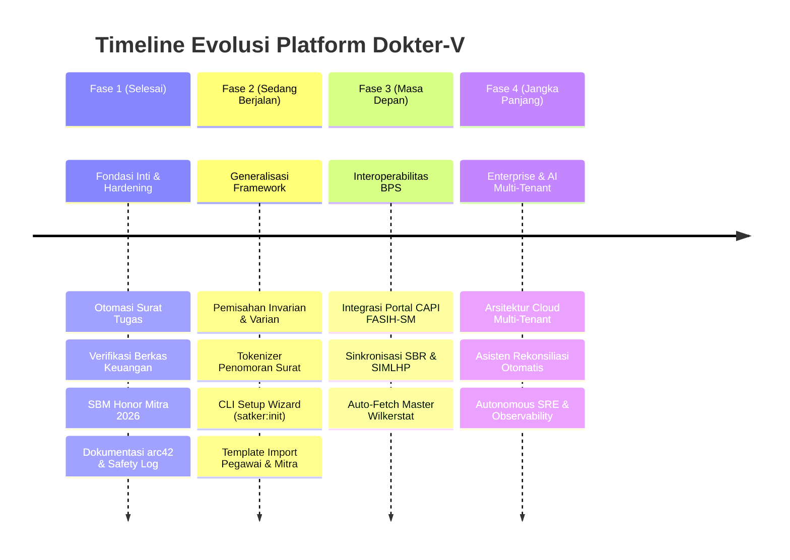

# Roadmap Pengembangan Dokter-V (Framework Tata Kelola & Otomasi BPS Kab/Kota)

> [!NOTE] **Visi Strategis Dokter-V**
> Menjadikan **Dokter-V** sebagai standar kerangka kerja (*framework*) tata kelola penugasan, persuratan dinas, verifikasi berkas keuangan, dan otomasi pembayaran honor mitra statistik yang **andal, adaptif, dan siap pakai untuk seluruh 514 Satuan Kerja BPS Kabupaten/Kota di Indonesia**.

---

## 1. Ikhtisar Arsitektur: Prinsip Invarian vs. Varian

Untuk memungkinkan Dokter-V diterapkan di kantor BPS mana pun tanpa perlu merombak ulang kode program (*no code rewrites*), rancang bangun Dokter-V mengadopsi prinsip pemisahan ketat:

```text
┌────────────────────────────────────────────────────────────────────────┐
│               DOKTER-V CORE FRAMEWORK ENGINE (INVARIANT)               │
│                                                                        │
│  • Mesin Validasi Batas Honor PMK SBM 2026 (Survei vs Sensus)          │
│  • State Machine Alur Persuratan & SPPD Perka BPS                      │
│  • Pipeline Verifikasi Berkas Pembayaran Keuangan                      │
│  • Algoritma Deteksi Jadwal Bertabrakan (Anti-Collision Engine)        │
│  • Gateway Notifikasi WhatsApp Otomatis & Opt-Out Handling             │
│  • SAML 2.0 BPS Single Sign-On (rIDM) & Filament RBAC Shield           │
│  • Runtime Performance Engine (FrankenPHP 8.4 + Octane + OPcache)      │
└───────────────────────────────────┬────────────────────────────────────┘
                                    │ Dikendalikan melalui
                                    ▼
┌────────────────────────────────────────────────────────────────────────┐
│             LAYER KONFIGURASI & PROFIL SATKER (SSOT ADAPTER)           │
│  config/satker.php  •  Tabel Settings  •  Tokenized Surat Templates   │
└───────────────────────────────────┬────────────────────────────────────┘
                                    │ Memuat data spesifik
                                    ▼
┌────────────────────────────────────────────────────────────────────────┐
│                   PROFIL SATUAN KERJA LOKAL (VARIANT)                  │
│                                                                        │
│  • Identitas Satker (Kode 4-digit, Nama Satker, Kedudukan Ibu Kota)    │
│  • Pejabat Definitif & PLH (KPA, Kasubbag TU/PPSPM, PPK, Bendahara)    │
│  • Master Wilayah Administratif & Preset Rute Perjadin Lokal           │
│  • Master Data Pegawai Organik & Database Mitra Statistik Lokal        │
│  • Nomor Akun DIPA / MAK & Gateway WhatsApp Satker                     │
└────────────────────────────────────────────────────────────────────────┘
```

---

## 2. Fase Pengembangan Strategis



---

### [FASE 1] — Fondasi Inti, Kepatuhan Aturan & Stabilitas Operasional
> **Status:** `SELESAI (COMPLETED)` | **Basis:** BPS Kabupaten Mempawah (6104)  
> **Dokumen Rencana & Rekam Jejak:** 👉 [**phase-01/README.md**](roadmap/phase-01/README.md)

- [x] **Surat Tugas & SPPD Engine**: Siklus hidup Surat Tugas, pembuatan SPPD otomatis, dan deteksi jadwal bertabrakan.
- [x] **SBM Honor Mitra Engine**: Pembatasan batas honor bulanan sesuai PMK Standar Biaya Masukan (SBM 2026) dan konsolidasi kontrak bulanan.
- [x] **Pipeline Verifikasi Pembayaran**: Verifikasi berkas keuangan berjenjang (Bendahara $\rightarrow$ PPSPM $\rightarrow$ PPK $\rightarrow$ Pencairan).
- [x] **WhatsApp Automation**: Notifikasi pengajuan, persetujuan pimpinan, revisi, dan penolakan via gateway Whatsmeow/Aina/Fonnte.
- [x] **Delegasi Approval**: Fleksibilitas approval pimpinan dialihkan ke Kasubbag TU (`ppspm`) via antarmuka Pengaturan.
- [x] **Dokumentasi Terstruktur**: Arsitektur enterprise modular berbasis arc42 ([`docs/architecture/`](architecture/01_introduction_and_goals.md)).
- [x] **Storage & Log Hardening**: Pencegahan crash loop, rotasi log harian (`daily`), pemangkasan log otomatis (>50MB), dan isolasi dependensi Docker.

---

### [FASE 2] — Generalisasi Framework Multi-Satker & Decoupling Invarian/Varian
> **Status:** `SEDANG BERJALAN (IN PROGRESS / READY FOR EXECUTION)`  
> **Dokumen Master Fase 2:** 👉 [**phase-02/README.md**](roadmap/phase-02/README.md)  
> **Katalog & Panduan Roadmap:** 👉 [`docs/roadmap/README.md`](roadmap/README.md)

Tujuan utama fase ini adalah memisahkan komponen invarian (inti tata kelola BPS) dari varian (spesifik satker) agar pengembang dari Satker BPS mana pun dapat mengkloning repositori ini dan menjalankannya untuk kantor mereka dalam waktu kurang dari 5 menit.

Karena rincian pekerjaan Fase 2 mencakup banyak modul arsitektur terpisah dan dapat berkembang hingga puluhan dokumen, setiap modul didefinisikan dalam **berkas rencana bernomor mandiri (*numbered plan files*)**:

| No. | Modul Kerja & Spesifikasi Teknis | Target Deliverable |
|:---:|:---|:---|
| 01 | [**01_ssot_konfigurasi_satker.md**](roadmap/phase-02/01_ssot_konfigurasi_satker.md) | Single Source of Truth `config/satker.php` & Helper Fallback |
| 02 | [**02_tokenizer_penomoran_surat.md**](roadmap/phase-02/02_tokenizer_penomoran_surat.md) | Mesin Template Nomor Surat Tugas, SPPD, SPK, BAST |
| 03 | [**03_desentralisasi_wilayah_dan_rute.md**](roadmap/phase-02/03_desentralisasi_wilayah_dan_rute.md) | Desentralisasi Wilayah, Preset Rute, & Prompt LPD AI |
| 04 | [**04_cli_setup_wizard_satker_init.md**](roadmap/phase-02/04_cli_setup_wizard_satker_init.md) | Interactive Wizard CLI: `php artisan satker:init` |
| 05 | [**05_scaffolding_import_export_data.md**](roadmap/phase-02/05_scaffolding_import_export_data.md) | Starter Pack: Data Pejabat, Pegawai, Mitra, & Master SLS |
| 06 | [**06_developer_quickstart_kit.md**](roadmap/phase-02/06_developer_quickstart_kit.md) | Docker Dev Starter & Panduan Onboarding Pengembang |
| 07 | [**07_branding_dan_kop_surat_dinamis.md**](roadmap/phase-02/07_branding_dan_kop_surat_dinamis.md) | Logo Satker & Komponen Kop Naskah Dinas PDF Dinamis |
| 08 | [**08_alokasi_anggaran_dipa_mak.md**](roadmap/phase-02/08_alokasi_anggaran_dipa_mak.md) | Manajemen Akun MAK DIPA Satker & Validasi Saldo |
| 09 | [**09_gateway_whatsapp_satker.md**](roadmap/phase-02/09_gateway_whatsapp_satker.md) | Profil Gateway Multi-Provider WhatsApp Satker |
| 10 | [**10_qa_matrix_regresi_mempawah.md**](roadmap/phase-02/10_qa_matrix_regresi_mempawah.md) | Matriks QA & Garansi 100% Zero-Regresi BPS Mempawah |
| 11 | [**11_fleksibilitas_autentikasi_dan_sso.md**](roadmap/phase-02/11_fleksibilitas_autentikasi_dan_sso.md) | Fleksibilitas Autentikasi: Mode Lokal (Email/Password), SSO SAML, dan Hybrid |

---

### [FASE 3] — Interoperabilitas Ekosistem BPS & Sinkronisasi Data Otomatis
> **Status:** `DIRENCANAKAN (PLANNED)`  
> **Dokumen Master Fase 3:** 👉 [**phase-03/README.md**](roadmap/phase-03/README.md)

Menghubungkan Dokter-V secara langsung dengan sistem-sistem nasional yang digunakan di lingkungan BPS:

- [ ] **Integrasi CAPI FASIH-SM**:
  - Penarikan otomatis beban kerja mitra, progres pencacahan, dan verifikasi foto lapangan responden dari portal FASIH.
- [ ] **Sinkronisasi SBR (Statistical Business Register)**:
  - Validasi direktori usaha/perusahaan untuk keperluan penugasan listing dan survei ekonomi.
- [ ] **Konektor Master Wilayah Wilkerstat / MFD Online**:
  - Penarikan batas wilayah blok sensus (SLS), desa, dan kecamatan langsung dari API Pusat BPS.
- [ ] **Integrasi SIMLHP**:
  - Pelaporan hasil pemeriksaan dan pengawasan fungsional langsung terhubung ke database pengawasan.

---

### [FASE 4] — Enterprise Cloud Multi-Tenant & Autonomous SRE
> **Status:** `VISI JANGKA PANJANG (FUTURE VISION)`  
> **Dokumen Master Fase 4:** 👉 [**phase-04/README.md**](roadmap/phase-04/README.md)

- [ ] **Arsitektur Multi-Tenancy**:
  - Opsi *Single Database Multi-Tenant* atau *Multi-Database per Tenant* untuk satker di lingkungan satu provinsi yang ingin di-host terpusat di server BPS Provinsi.
- [ ] **Autonomous Financial Reconciliation Agents**:
  - Agen AI yang memverifikasi kesesuaian kwitansi, SPK, BAST, dan saldo kas secara otomatis sebelum disetujui PPK.
- [ ] **Telemetry Terpadu (Sentry & OpenTelemetry)**:
  - Pemantauan kinerja, pelacakan *slow queries*, dan deteksi dini anomali sistem secara terpusat.

---

## 3. Rujukan Dokumen Terkait
- [Katalog Paket Roadmap & Modul Bernomor](roadmap/README.md)
- [Rencana Pelaksanaan Fase 2: Generalisasi Framework](roadmap/phase-02/README.md)
- [Dokumentasi Arsitektur Sistem (arc42)](architecture/01_introduction_and_goals.md)
- [Aturan Bisnis & Kontrak Keuangan](BUSINESS_RULES.md)
- [Standar Operasional Prosedur (SOP)](SOP_DOKTER-V.md)
- [Panduan Produksi & Deployment](../PRODUCTION_GUIDE.md)
