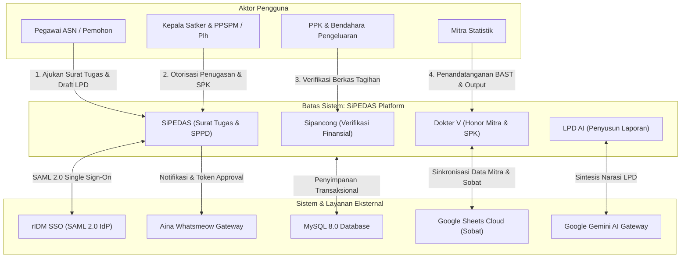
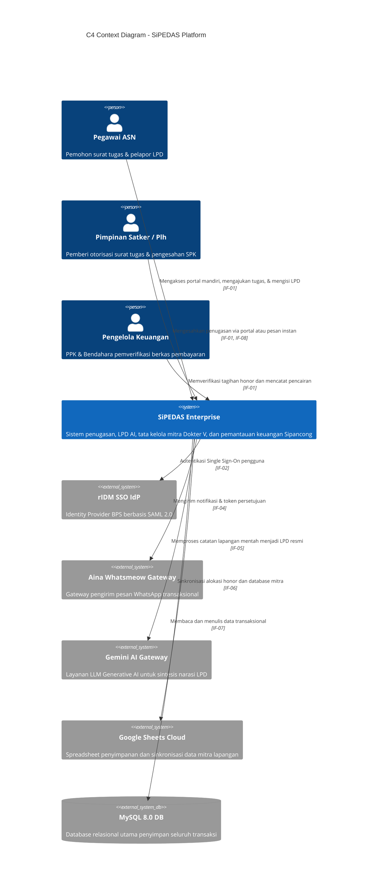

# 3. Konteks dan Cakupan (Context and Scope)

> [!INFO] **Architecture Provenance & Freshness**
> - **Verified Commit**: `9cc0f0e` (branch: `main`)
> - **Verified Timestamp**: `2026-10-27T18:56:09+07:00`
> - **Tracked Paths**: `app/`, `routes/`, `config/`, `database/`
> - **Drift Status**: `verified`

Seksi ini memetakan batasan sistem SiPEDAS terhadap sistem eksternal, aktor pengguna, serta antarmuka komunikasi data (antarmuka teknis dan bisnis).

---

## 3.1 Konteks Bisnis (Business Context)

SiPEDAS beroperasi di tengah ekosistem manajemen aparatur, perbendaharaan daerah, dan tata kelola mitra sensus/survei Badan Pusat Statistik (BPS).

---

## 3.2 Konteks Teknis & Antarmuka Eksternal (Technical Context & Interfaces)

Tabel berikut mendefinisikan seluruh antarmuka integrasi eksternal (`IF-xx`) yang dipertukarkan oleh batas sistem SiPEDAS:

| Antarmuka | Nama Antarmuka | Protokol / Format | Deskripsi & Arah Pertukaran Data |
|:---|:---|:---|:---|
| IF-01 | Filament Web UI | HTTPS / HTML & Livewire | Antarmuka pengguna interaktif bagi ASN, verifikator keuangan, dan pimpinan untuk manajemen tugas, verifikasi honor, dan monitoring. |
| IF-02 | SAML 2.0 Identity Provider | HTTPS / SAML 2.0 XML Post-Binding | Autentikasi Single Sign-On terpusat via rIDM BPS (`/saml/*`) untuk verifikasi identitas aparatur sipil negara. |
| IF-03 | Agent-Native REST API | HTTPS / JSON REST (`/v1/*`) | Antarmuka terprogram untuk agen AI dan klien otomasi dengan autentikasi API Key (`X-API-KEY`) dan spesifikasi OpenAPI/Skill.md. |
| IF-04 | WhatsApp Gateway | HTTPS / JSON REST API | Saluran notifikasi pesan instan transaksional ke pegawai/mitra melalui Aina Whatsmeow Gateway dengan failover otomatis ke Fonnte. |
| IF-05 | Generative AI Gateway | HTTPS / JSON OpenAI-Compatible | Integrasi pemrosesan bahasa alami (LLM Google Gemini) via AI gateway proxy (`ai.dvlpid.my.id/v1/chat/completions`) untuk penulisan LPD. |
| IF-06 | Google Sheets Cloud Integration | HTTPS / Google Sheets v4 API | Integrasi dua arah dengan Google Spreadsheet master mitra/honor untuk impor/ekspor data massal dan integrasi data rekrutmen Sobat BPS. |
| IF-07 | Relational Database Persistence | TCP / MySQL Wire Protocol | Penyimpanan data persisten transaksional (ACID) untuk seluruh relasi data penugasan, honor, bukti potong pajak, dan log audit. |
| IF-08 | One-Click Approval Token Webhook | HTTPS / Signed Token GET Endpoint | Endpoint publik aman (`/approve/{token}`) yang memvalidasi token SHA-256 berbatas waktu untuk persetujuan surat tugas langsung dari tautan WhatsApp. |

---

## 3.3 Diagram Konteks C4 (C4Context)

