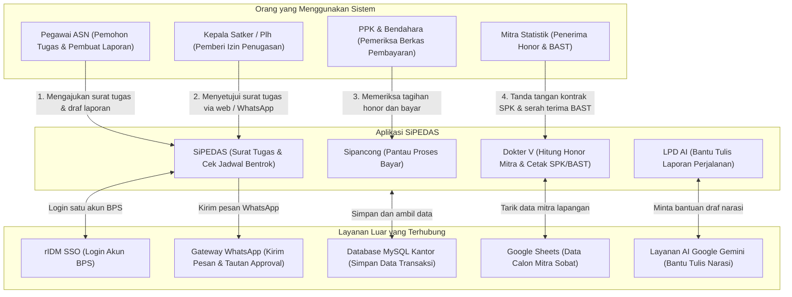
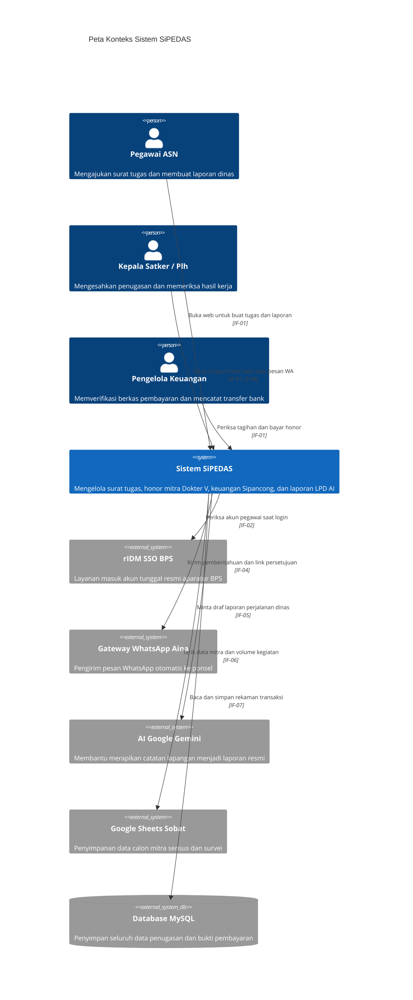

# 3. Konteks dan Cakupan Sistem (Context and Scope)

> [!INFO] **Architecture Provenance & Freshness**
> - **Verified Commit**: `9cc0f0e` (branch: `main`)
> - **Verified Timestamp**: `2026-10-27T18:56:09+07:00`
> - **Tracked Paths**: `app/`, `routes/`, `config/`, `database/`
> - **Drift Status**: `verified`

Seksi ini memetakan siapa saja yang menggunakan sistem SiPEDAS, dengan sistem apa saja SiPEDAS terhubung, dan lewat jalur mana data mengalir.

---

## 3.1 Hubungan Pengguna dan Sistem Sekitar

Secara garis besar, SiPEDAS menghubungkan pegawai, pimpinan, pengelola keuangan, dan mitra kerja dengan database kantor serta layanan eksternal:

---

## 3.2 Daftar Jalur Komunikasi Data (Antarmuka Sistem)

Tabel berikut mencantumkan seluruh jalur masuk dan keluar data pada sistem SiPEDAS:

| Antarmuka | Nama Jalur | Cara Berkomunikasi | Apa yang Dilakukan Jalur Ini? |
|:---|:---|:---|:---|
| IF-01 | Filament Web UI | Halaman Web HTTPS | Halaman web utama yang dibuka oleh pegawai, bendahara, dan pimpinan untuk mengisi formulir, melihat data tabel, dan mengunduh berkas PDF/Excel. |
| IF-02 | SAML 2.0 Identity Provider | Jalur Masuk Akun Tunggal (SSO) | Mengarahkan pegawai untuk masuk menggunakan akun resmi BPS (rIDM) tanpa perlu menghafal kata sandi baru khusus aplikasi ini. |
| IF-03 | Agent-Native REST API | Jalur API Data Terprogram | Pintu khusus yang aman (menggunakan kunci rahasia API Key) jika ada program otomatis atau bot asisten yang membutuhkan data penugasan/mitra. |
| IF-04 | WhatsApp Gateway | Pengiriman Pesan WhatsApp | Mengirimkan pesan pemberitahuan otomatis ke nomor HP pegawai atau pimpinan melalui mesin Whatsmeow kantor, dengan cadangan otomatis ke Fonnte. |
| IF-05 | Generative AI Gateway | Layanan Kecerdasan Buatan | Mengirimkan catatan kasar dan foto dari lapangan ke AI Google Gemini untuk dibantu disusun menjadi draf laporan dinas resmi yang rapi. |
| IF-06 | Google Sheets Cloud Integration | Sinkronisasi Lembar Kerja Google | Menghubungkan sistem ke Google Spreadsheet agar koordinator sensus/survei bisa menarik data mitra dari pangkalan data Sobat BPS dengan mudah. |
| IF-07 | Relational Database Persistence | Jalur Penyimpanan Database MySQL | Tempat penyimpanan permanen seluruh data penugasan, nomor surat, nominal honor, bukti potong pajak, dan catatan riwayat perubahan. |
| IF-08 | One-Click Approval Token Webhook | Tautan Persetujuan Kilat di WhatsApp | Tautan aman berbatas waktu yang ada di pesan WA pimpinan (`/approve/{token}`). Pimpinan cukup klik tautan ini dari HP untuk mengesahkan tugas dinas. |

---

## 3.3 Gambaran Konteks Sistem Keseluruhan (Diagram C4Context)

