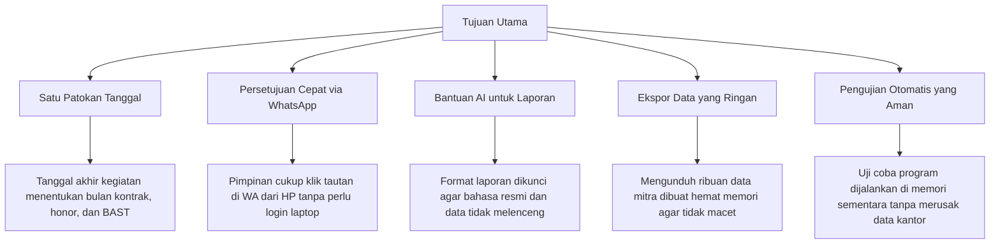

# 4. Strategi Solusi (Solution Strategy)

> [!INFO] **Architecture Provenance & Freshness**
> - **Verified Commit**: `9cc0f0e` (branch: `main`)
> - **Verified Timestamp**: `2026-10-27T18:56:09+07:00`
> - **Tracked Paths**: `app/`, `routes/`, `config/`, `database/`
> - **Drift Status**: `verified`

Seksi ini menjelaskan pendekatan praktis yang diambil dalam membangun sistem SiPEDAS untuk menyelesaikan persoalan nyata di lapangan secara sederhana dan efektif.

---

## 4.1 Ringkasan Pendekatan Utama

---

## 4.2 Cara Sistem Menyelesaikan Masalah

### 1. Menghilangkan Tanggal yang Tidak Sinkron (Satu Patokan Tanggal)
- **Masalah**: Dulu, tanggal kegiatan survei, tanggal kontrak (SPK), dan tanggal penyerahan hasil (BAST) sering diisi sendiri-sendiri di form yang berbeda. Akibatnya sering terjadi selisih bulan antara tanggal kerja dan tanggal bayar yang menjadi temuan saat pemeriksaan keuangan.
- **Solusi**: Sistem menetapkan satu tanggal pasti: **`tanggal_akhir_kegiatan`** pada data honor. Dari tanggal ini, sistem secara otomatis menentukan:
  - Masuk ke bulan honor yang mana.
  - Berapa batas honor bulanan yang tersisa untuk mitra tersebut.
  - Tanggal resmi yang tertulis pada kontrak SPK dan lembar BAST.
  Dengan begitu, semua dokumen penugasan dan pembayaran dijamin selalu cocok dan selaras.

### 2. Mempercepat Persetujuan Surat Tugas Tanpa Membebani Pimpinan
- **Masalah**: Pegawai sering harus menunggu berhari-hari agar surat tugas ditandatangani karena pimpinan sedang dinas luar atau rapat penting.
- **Solusi**:
  - **Pencegahan Jadwal Bentrok**: Begitu pegawai memilih tanggal tugas dan nama rekan kerja, sistem langsung mengecek kalender kantor. Jika salah satu pegawai sudah punya tugas dinas aktif di tanggal tersebut, sistem langsung memberi tahu dan menolak pengajuan.
  - **Tautan Persetujuan Kilat di WhatsApp**: Pimpinan menerima ringkasan tugas di WA bersama sebuah tautan aman berbatas waktu. Cukup klik tautan itu dari layar HP, surat tugas langsung disahkan, nomor surat otomatis terbit, dan pegawai langsung mendapat kabar bahwa surat siap dicetak.
  - **Pengalihan Otomatis ke Plh**: Jika pimpinan sedang cuti panjang, wewenang otomatis beralih ke Pelaksana Harian yang ditunjuk resmi.

### 3. Mengurangi Beban Mengetik Laporan Menggunakan AI
- **Masalah**: Setelah pulang dari dinas luar, pegawai sering menunda membuat laporan perjalanan dinas karena repot merangkai kalimat formal dari catatan lapangan yang masih berupa poin-poin singkat.
- **Solusi**:
  - Modul LPD AI meminta pegawai memasukkan catatan ringkas kegiatan, lokasi, dan foto bukti.
  - Catatan tersebut dikirim ke AI Google Gemini dengan perintah tegas: susun menjadi struktur resmi (Latar Belakang, Maksud dan Tujuan, Waktu dan Tempat, Hasil Kegiatan, serta Saran/Kesimpulan).
  - Struktur hasil AI dikunci dalam bentuk isian baku, menjaga kebenaran data fakta/angka tanpa karangan bebas (*tanpa halusinasi*), dan langsung bisa ditinjau pegawai sebelum dicetak jadi PDF.

### 4. Menghormati Kenyamanan Notifikasi Pengguna
- **Masalah**: Pengiriman notifikasi otomatis jika terlalu sering bisa mengganggu pegawai atau pimpinan di luar jam kerja.
- **Solusi**:
  - Disediakan menu pengaturan (*opt-out*). Pegawai bisa memilih notifikasi apa saja yang ingin diterima di WhatsApp pribadinya.
  - Format nomor telepon otomatis diseragamkan ke format standar (misal nomor `0812...` otomatis diubah menjadi `62812...`) agar pesan selalu sampai.
  - Pengaturan yang sudah disimpan pengguna dijamin tidak akan terhapus saat ada pembaruan versi aplikasi (*update deploy*).

### 5. Mengunduh Data Mitra yang Banyak Tanpa Membuat Komputer Macet
- **Masalah**: Saat koordinator ingin mengecek data ribuan mitra dan mengunduh berkas perencanaan dalam format Excel, aplikasi web biasa sering macet atau kehabisan memori (*Out of Memory*).
- **Solusi**:
  - Data mitra dikelompokkan ke dalam 4 kategori kesiapan yang jelas: mana yang **Siap Ditugaskan**, mana yang **Berlebih**, mana yang **Kosong**, dan mana yang **Kelebihan Beban (Overload)**.
  - Proses pembuatan berkas Excel dialirkan sedikit demi sedikit langsung ke peramban pengguna, sehingga penggunaan memori komputer server tetap sangat kecil dan stabil.

### 6. Pengujian Program yang Aman Tanpa Merusak Data Kantor
- **Masalah**: Pengembang sistem perlu menguji fitur baru secara menyeluruh, tetapi jika pengujian menyentuh database kantor, ada risiko data penting terhapus atau berubah.
- **Solusi**:
  - Pengujian otomatis dijalankan menggunakan ruang memori sementara yang terpisah sepenuhnya dari database kantor.
  - Pengujian menguji logika nyata perhitungan honor dan aturan SBM secara nyata tanpa menggunakan data rekayasa palsu, sehingga menjamin aplikasi bekerja dengan benar saat dipakai sehari-hari.
