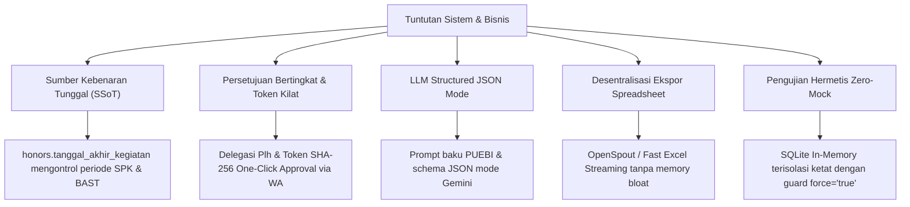

# 4. Strategi Solusi (Solution Strategy)

> [!INFO] **Architecture Provenance & Freshness**
> - **Verified Commit**: `9cc0f0e` (branch: `main`)
> - **Verified Timestamp**: `2026-10-27T18:56:09+07:00`
> - **Tracked Paths**: `app/`, `routes/`, `config/`, `database/`
> - **Drift Status**: `verified`

Seksi ini menjelaskan keputusan fundamental dan strategi arsitektural yang diambil untuk memenuhi kebutuhan fungsional dan sasaran mutu sistem SiPEDAS.

---

## 4.1 Ringkasan Keputusan Arsitektur Kunci

---

## 4.2 Strategi Solusi Rinci

### 1. Sumber Kebenaran Tunggal Tanggal Kontrak (Single Source of Truth)
- **Tantangan**: Sebelumnya, pengisian periode kontrak mitra, tanggal BAST, dan tanggal akhir kegiatan sering mengalami inkonsistensi (*drift*) karena dimasukkan terpisah di beberapa tabel. Hal ini memicu temuan audit terkait ketidaksesuaian tanggal pembayaran honor terhadap bulan pelaksanaan survei.
- **Strategi Solusi**: Menetapkan kolom `tanggal_akhir_kegiatan` pada tabel `honors` sebagai **Single Source of Truth**. Tanggal ini secara deterministik menentukan:
  - Bulan alokasi dan batas SBM mitra terkait.
  - Mekanisme pengelompokan (*bundling*) kontrak bulanan untuk survei vs kontrak per-kegiatan untuk sensus.
  - Tanggal efektif penandatanganan SPK dan penerbitan BAST.
  Semua form UI dan query reporting wajib mengacu pada kolom ini, meniadakan kalkulasi tanggal tiruan.

### 2. Delegasi Persetujuan Bertingkat & One-Click WhatsApp Approval
- **Tantangan**: Proses birokrasi penandatanganan surat tugas sering terhambat saat pejabat definitif (Kepala Satker / Kasubbag TU) sedang dinas luar atau cuti, sementara operasional lapangan memerlukan legalitas mendesak.
- **Strategi Solusi**:
  - Menyediakan mekanisme **Pelaksana Harian (Plh)** otomatis yang mengalihkan hak penandatanganan sesuai SK penunjukan.
  - Algoritma **Deteksi Bentrok Jadwal**: Saat surat tugas diajukan, sistem secara otomatis mengecek jadwal seluruh pegawai yang terlibat pada rentang tanggal tersebut. Jika terdeteksi tumpang tindih dengan tugas dinas lain, sistem memblokir pengajuan dan memberi peringatan eksplisit.
  - **One-Click Approval via Token**: Pimpinan menerima ringkasan tugas di WhatsApp beserta tautan approval terenkripsi HMAC SHA-256 berbatas waktu. Pimpinan cukup menekan tautan tersebut untuk mengesahkan tugas secara sah tanpa perlu login ulang ke portal web.

### 3. Ekstraksi Dokumen & Sintesis Narasi LPD Berbasis Generative AI
- **Tantangan**: Penyusunan Laporan Perjalanan Dinas (LPD) oleh aparatur kerap tertunda berminggu-minggu karena beban mengetik narasi formal dari catatan lapangan kasar.
- **Strategi Solusi**:
  - Mengintegrasikan modul `LPD AI` dengan arsitektur **Zero Local CPU Load**. Modul mengirimkan catatan poin-poin mentah, lokasi, dan foto ke AI Gateway upstream (`ai.dvlpid.my.id/v1/chat/completions` menggunakan model Gemini Flash).
  - Menerapkan **Structured JSON Mode**: Respons LLM dikunci dalam skema JSON baku (Latar Belakang, Landasan Hukum, Maksud dan Tujuan, Waktu dan Tempat, Hasil Pelaksanaan Tugas, serta Kesimpulan & Rekomendasi).
  - Menerapkan aturan PUEBI/EYD yang ketat, melarang halusinasi, dan memastikan narasi mempertahankan angka atau fakta riil lapangan.

### 4. Manajemen Opt-Out Notifikasi WhatsApp Bertingkat
- **Tantangan**: Pengiriman notifikasi massal WhatsApp untuk pengajuan pembayaran honor atau penugasan dapat mengganggu pejabat tertentu yang menghendaki notifikasi terfilter, atau berpotensi terblokir jika nomor tujuan tidak valid.
- **Strategi Solusi**:
  - Menerapkan tabel `whatsapp_opt_outs` dengan strategi resolusi 3 lapis:
    1. *Global Master Switch*: Menonaktifkan seluruh notifikasi sistem sementara jika gateway mengalami kendala.
    2. *Event-Based Opt-Out*: Pegawai dapat memilih jenis notifikasi (hanya penugasan, hanya pembayaran honor Dokter V, atau semua).
    3. *Employee Specific & Phone Normalization*: Normalisasi nomor telepon otomatis ke format standar internasional E.164 (`628xxx`) sebelum pengiriman.
  - Mekanisme seeder aman (*idempotent seeder*): Menggunakan `updateOrCreate` pada seeder dan migrasi sehingga konfigurasi opt-out yang diisi pengguna di database produksi tidak terhapus saat redeploy.

### 5. Arsitektur Monitoring Kesiapan Alokasi Mitra & Ekspor Streaming Excel
- **Tantangan**: Rekonsiliasi bulanan ribuan mitra survei memerlukan klasifikasi status kesiapan (Siap Ditugaskan, Berlebih, Kosong, Overload) dan ekspor spreadsheet untuk perencanaan lapangan tanpa memicu *Out-Of-Memory* (OOM).
- **Strategi Solusi**:
  - Mengelompokkan kesiapan alokasi dalam 4 kuadran matematis yang dihitung dari akumulasi honor terhadap batas SBM (Rp 3.353.000 untuk survei, Rp 4.694.000 untuk sensus).
  - Ekspor Excel memanfaatkan *streaming writer* (FastExcel / OpenSpout) yang memproses baris secara bertahap (*chunking*) langsung ke output stream HTTP dengan alokasi memori datar $O(1)$.

### 6. Isolasi Pengujian Hermetis & Kebijakan Zero-Mock
- **Tantangan**: Pengujian unit dan integrasi yang menyentuh database produksi berisiko mengotori data riil atau mengalami kegagalan akibat dependensi eksternal.
- **Strategi Solusi**:
  - Menggunakan konfigurasi pengujian mandiri dalam `phpunit.xml` dengan memori SQLite (`:memory:`) dan penegakan `force="true"`.
  - Menerapkan doktrin **Zero-Mock**: Logika bisnis, kalkulasi SBM, relasi Eloquent, dan alur otorisasi diuji terhadap database relasional in-memory asli tanpa menggunakan mock tiruan yang rapuh.
