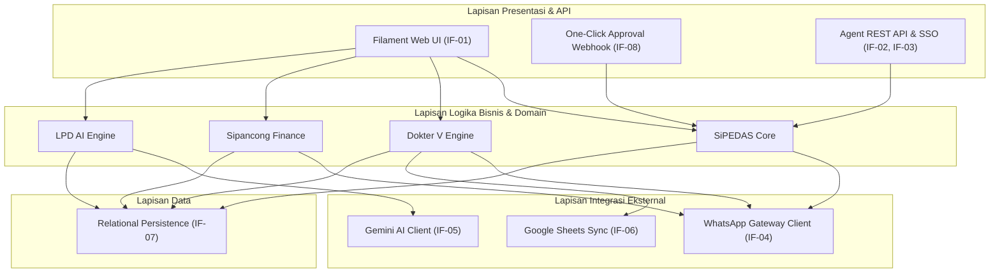

# 5. Tinjauan Blok Pembangun (Building Block View)

> [!INFO] **Architecture Provenance & Freshness**
> - **Verified Commit**: `9cc0f0e` (branch: `main`)
> - **Verified Timestamp**: `2026-10-27T18:56:09+07:00`
> - **Tracked Paths**: `app/`, `routes/`, `config/`, `database/`
> - **Drift Status**: `verified`

Seksi ini memetakan dekomposisi statis sistem SiPEDAS dari level subsistem (C4 Level 1/2) hingga komponen internal (C4 Level 3).

---

## 5.1 Dekomposisi Sistem Level 1 (Whitebox Overall System)

SiPEDAS diorganisasi ke dalam 7 blok pembangun utama yang saling berinteraksi:

### Tabel Komponen Level 1 & Pemetaan Antarmuka

| Name | Responsibility | Interfaces |
|:---|:---|:---|
| SiPEDAS Core | Manajemen siklus hidup surat tugas, deteksi bentrok jadwal personel, penomoran otomatis, dan otorisasi berjenjang (Kepala Satker, Kasubbag TU, Plh). | IF-01, IF-04, IF-08 |
| Dokter V Engine | Tata kelola database mitra sensus/survei, validasi batas akumulasi honor SBM 2026, bundling kontrak bulanan, penerbitan SPK & BAST, serta monitoring kesiapan alokasi mitra. | IF-01, IF-06 |
| Sipancong Finance | Verifikasi multi-tahap berkas tagihan keuangan (Bendahara $\rightarrow$ PPSPM $\rightarrow$ PPK), pemantauan SLA verifikasi, dan pencatatan realisasi pencairan dana. | IF-01 |
| LPD AI Engine | Sintesis laporan perjalanan dinas berbasis kecerdasan buatan, pemrosesan catatan lapangan mentah menjadi format narasi resmi PUEBI dalam format JSON baku. | IF-01, IF-05 |
| WhatsApp Gateway Client | Pengiriman notifikasi transaksional terpusat ke pegawai dan mitra, failover otomatis Aina Whatsmeow ke Fonnte, serta manajemen preferensi opt-out bertingkat. | IF-04 |
| SAML & Agent Auth API | Autentikasi Single Sign-On rIDM BPS via protokol SAML 2.0 serta penyediaan API programmatic ramah AI-agent dengan autentikasi API Key terisolasi. | IF-02, IF-03 |
| Relational Persistence | Penyimpanan transaksional integritas tinggi (ACID), manajemen skema migrasi database, relasi Eloquent, dan penguncian baris pesimis saat alokasi honor. | IF-07 |

---

## 5.2 Dekomposisi Rinci Subsistem (Level 2 Building Blocks)

### 1. SiPEDAS Core (`app/Filament/Resources/PenugasanResource.php`, `app/Models/Penugasan.php`)
- **PenugasanResource**: Form builder pengajuan surat tugas, pemilih pegawai dinas multi-select, penentuan akun anggaran MAK, dan status approval.
- **DeteksiBentrokService**: Query pemeriksa tumpang-tindih tanggal penugasan antar pegawai untuk mencegah ASN ditugaskan ke dua tempat berbeda di waktu bersamaan.
- **ApprovalTokenManager**: Generator token bertandatangan HMAC SHA-256 berbatas waktu (masa berlaku 7 hari) yang disisipkan ke pesan WhatsApp pimpinan.

### 2. Dokter V Engine (`app/Filament/Resources/HonorResource.php`, `app/Filament/Pages/MonitorHonorMitra.php`, `app/Models/Honor.php`)
- **HonorResource**: Formulir input honorarium mitra per kegiatan sensus/survei dengan integrasi Single Source of Truth `tanggal_akhir_kegiatan`.
- **SBMValidator**: Algoritma kalkulasi akumulasi honor per mitra per bulan kalender. Memblokir penyimpanan jika melebihi plafon SBM (Survei Rp 3.353.000, Sensus Rp 4.694.000).
- **SpkAndBastGenerator**: Template generator cetak SPK bulanan gabungan (Survei) dan SPK per kegiatan (Sensus) beserta lembar BAST digital.
- **MonitorHonorMitra**: Dashboard analisis kesiapan alokasi mitra dalam 4 kategori (Siap Ditugaskan, Berlebih, Kosong, Overload) dengan ekspor spreadsheet multi-sheet.

### 3. Sipancong Finance (`app/Filament/Resources/PengajuanResource.php`, `app/Models/Pengajuan.php`)
- **PengajuanResource**: Manajemen berkas tagihan keuangan dan riwayat pembayaran.
- **WorkflowVerifikasiManager**: State machine transisi status berkas dari *Draft* $\rightarrow$ *Verifikasi Bendahara* $\rightarrow$ *Pengujian PPSPM* $\rightarrow$ *Persetujuan PPK* $\rightarrow$ *Pencairan Selesai*.

### 4. LPD AI Engine (`app/Services/AIService.php`, `app/Filament/Pages/LaporanPerjalananDinas.php`)
- **AIService**: Klien HTTP berorientasi asinkron yang memanggil API AI Gateway (`ai.dvlpid.my.id/v1/chat/completions`) dengan system prompt PUEBI/EYD pemerintah.
- **LPDParser**: Parser yang mengonversi respons JSON terstruktur menjadi draft laporan terformat lengkap dengan tombol ekspor PDF dan integrasi foto dokumentasi.

### 5. WhatsApp Gateway Client (`app/Services/WhatsappNotifier.php`, `app/Models/WhatsappOptOut.php`)
- **WhatsappNotifier**: Service sentral pengiriman pesan WhatsApp yang menangani *queueing*, sanitasi teks, dan fallback gateway.
- **OptOutResolver**: Penilai kelayakan pengiriman pesan berdasarkan tabel `whatsapp_opt_outs` (apakah nomor penerima atau jenis kegiatan masuk dalam daftar abaikan).
