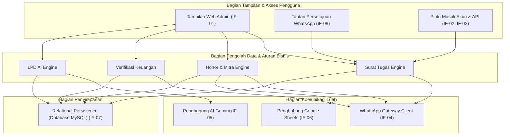

# 5. Bagian-Bagian Penyusun Sistem (Building Block View)

> [!INFO] **Architecture Provenance & Freshness**
> - **Verified Commit**: `4235153` (branch: `main`)
> - **Verified Timestamp**: `2026-10-28T12:30:00+07:00`
> - **Tracked Paths**: `app/`, `routes/`, `config/`, `database/`
> - **Drift Status**: `verified`

Seksi ini menguraikan bagian-bagian utama yang membentuk sistem Dokter-V dan tugas dari masing-masing bagian tersebut.

---

## 5.1 Susunan Komponen Utama Sistem

Sistem Dokter-V dibagi ke dalam 7 bagian utama yang saling bekerja sama:

### Tabel Bagian Penyusun Sistem dan Jalurnya

| Name | Responsibility | Interfaces |
|:---|:---|:---|
| Surat Tugas Engine | Mengelola pengajuan surat tugas pegawai, mengecek jadwal dinas yang bertabrakan, memberi nomor surat resmi, dan menangani alur persetujuan pimpinan atau Plh. | IF-01, IF-04, IF-08 |
| Honor & Mitra Engine | Mengelola data mitra lapangan, mengecek batas maksimal honor bulanan (aturan SBM), menggabungkan kontrak kerja (SPK), menerbitkan berita acara (BAST), dan memantau beban kerja mitra. | IF-01, IF-06 |
| Verifikasi Keuangan | Memeriksa berkas tagihan secara berurutan (Bendahara $\rightarrow$ PPSPM $\rightarrow$ PPK), memantau kecepatan proses berkas, dan mencatat nomor bukti transfer pembayaran ke bank. | IF-01 |
| LPD AI Engine | Membantu pegawai menyusun laporan perjalanan dinas dari catatan ringkas dan foto lapangan menjadi draf laporan resmi yang rapi dan siap cetak. | IF-01, IF-05 |
| WhatsApp Gateway Client | Mengirim pesan pemberitahuan otomatis ke nomor HP pegawai dan pimpinan, serta mengelola daftar nomor yang tidak ingin dikirimi pesan tertentu. | IF-04 |
| SAML & Agent Auth API | Memeriksa login satu akun resmi BPS (SSO rIDM) dan menyediakan pintu akses data terprogram yang aman untuk bot/skrip otomatis. | IF-02, IF-03 |
| Relational Persistence | Menyimpan seluruh data secara permanen di database MySQL agar data aman, tidak tertukar, dan tidak hilang. | IF-07 |

---

## 5.2 Rincian Cara Kerja Masing-Masing Bagian

### 1. Modul Surat Tugas (Surat Tugas Engine)
- Lokasi kode: [`app/Filament/Resources/PenugasanResource.php`](file:///root/projects/sipedas/app/Filament/Resources/PenugasanResource.php), [`app/Models/Penugasan.php`](file:///root/projects/sipedas/app/Models/Penugasan.php), [`app/Http/Controllers/SuratTugasQuickApprovalController.php`](file:///root/projects/sipedas/app/Http/Controllers/SuratTugasQuickApprovalController.php), dan [`app/Services/SuratTugas/`](file:///root/projects/sipedas/app/Services/SuratTugas/).
- **Formulir Pengajuan**: Pegawai memilih tanggal berangkat, tanggal pulang, tujuan, mata anggaran (MAK), dan siapa saja pegawai yang ikut bertugas.
- **Pengecek Jadwal Bentrok**: Sebelum disimpan, sistem otomatis mencocokkan tanggal dengan riwayat tugas pegawai yang dipilih. Jika ada yang sedang dinas di hari yang sama, sistem langsung menolak dan memunculkan peringatan.
- **Pembuat Tautan WA Kriptografis (1-Click Approval)**: Menghasilkan temporary signed route ber-HMAC yang dikirim ke pengesah yang didelegasikan (`st_approval_mode`). Pimpinan cukup sekali klik dari HP tanpa login, dilengkapi deteksi bot crawler untuk mencegah persetujuan prematur saat WhatsApp me-load preview tautan.

### 2. Modul Honor & Mitra (Honor & Mitra Engine)
- Lokasi kode: [`app/Filament/Resources/HonorResource.php`](file:///root/projects/sipedas/app/Filament/Resources/HonorResource.php) dan [`app/Filament/Pages/MonitorHonorMitra.php`](file:///root/projects/sipedas/app/Filament/Pages/MonitorHonorMitra.php).
- **Pengontrol Batas Honor (SBM 2026)**: Menghitung total honor yang sudah dialokasikan kepada seorang mitra pada bulan bersangkutan. Jika alokasi baru membuat totalnya melewati batas resmi (Rp 3.353.000 untuk survei atau Rp 4.694.000 untuk sensus), penyimpanan otomatis dibatalkan.
- **Pencetak Kontrak (SPK) & BAST**: Membuat naskah kontrak kerja bulanan dan lembar serah terima hasil kerja yang bisa langsung dicetak dalam bentuk PDF resmi instansi.
- **Layar Pantau Mitra**: Menampilkan dashboard yang menunjukkan mitra mana yang jadwalnya masih kosong, pas, atau terlalu padat, serta bisa diunduh ke Excel.

### 3. Modul Verifikasi Keuangan (Verifikasi Keuangan)
- Lokasi kode: [`app/Filament/Resources/PengajuanResource.php`](file:///root/projects/sipedas/app/Filament/Resources/PengajuanResource.php) dan [`app/Models/Pengajuan.php`](file:///root/projects/sipedas/app/Models/Pengajuan.php).
- **Jalur Berkas Berjenjang**: Memastikan berkas diperiksa langkah demi langkah. Bendahara memeriksa bukti fisik awal $\rightarrow$ PPSPM memeriksa ketersediaan anggaran DIPA $\rightarrow$ PPK menyetujui perintah bayar $\rightarrow$ Bendahara mencatat nomor bukti transfer bank.

### 4. Modul Pembuat Laporan Berbantuan AI (LPD AI Engine)
- Lokasi kode: [`app/Services/AIService.php`](file:///root/projects/sipedas/app/Services/AIService.php) dan [`app/Filament/Pages/LaporanPerjalananDinas.php`](file:///root/projects/sipedas/app/Filament/Pages/LaporanPerjalananDinas.php).
- Menghubungkan aplikasi ke layanan kecerdasan buatan Google Gemini. Catatan lapangan disusun menjadi bab-bab standar: Latar Belakang, Maksud Kegiatan, Waktu dan Tempat, Hasil Pelaksanaan, serta Kesimpulan dan Saran.

### 5. Modul Pengirim Pesan (WhatsApp Gateway Client)
- Lokasi kode: [`app/Services/WhatsappNotifier.php`](file:///root/projects/sipedas/app/Services/WhatsappNotifier.php) dan [`app/Models/WhatsappOptOut.php`](file:///root/projects/sipedas/app/Models/WhatsappOptOut.php).
- Mengirim pesan dengan aman. Jika mesin WhatsApp utama sedang sibuk atau mati, sistem otomatis beralih ke saluran cadangan agar pesan pemberitahuan tetap sampai ke pegawai.
