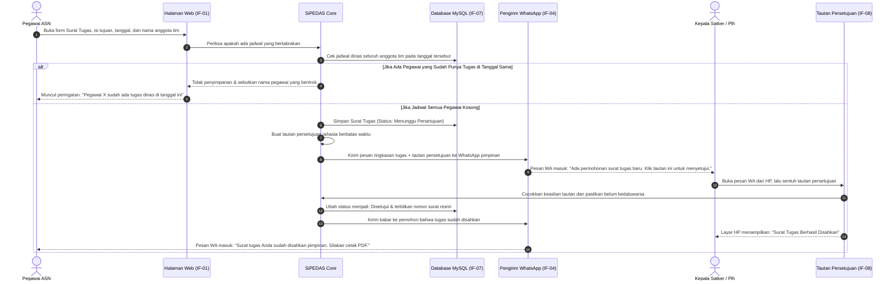
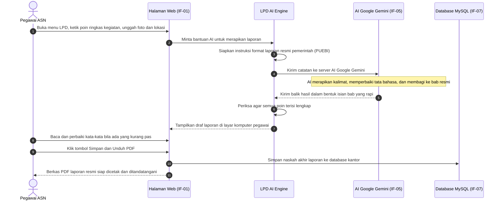
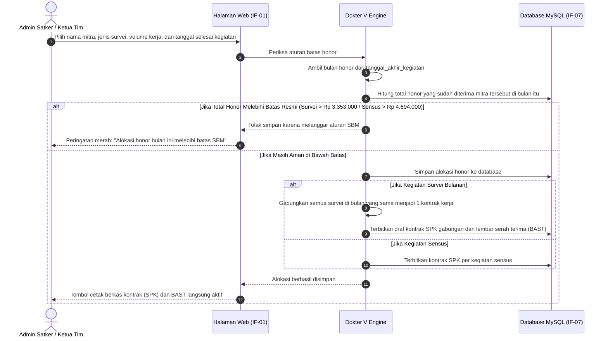
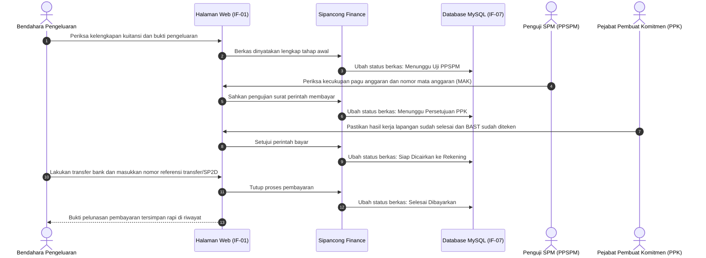

# 6. Alur Kerja Sistem (Runtime View)

> [!INFO] **Architecture Provenance & Freshness**
> - **Verified Commit**: `9cc0f0e` (branch: `main`)
> - **Verified Timestamp**: `2026-10-27T18:56:09+07:00`
> - **Tracked Paths**: `app/`, `routes/`, `config/`, `database/`
> - **Drift Status**: `verified`

Seksi ini menceritakan urutan kejadian langkah demi langkah saat pengguna menggunakan fitur-fitur penting dalam sistem SiPEDAS.

---

## 6.1 Alur 1: Mengajukan Surat Tugas, Cek Jadwal Bentrok, dan Setuju via WhatsApp

Alur ini menjelaskan bagaimana pegawai mengajukan tugas dinas hingga disahkan oleh pimpinan lewat pesan WhatsApp:

---

## 6.2 Alur 2: Menyusun Laporan Perjalanan Dinas Dibantu AI (LPD AI)

Alur ketika pegawai pulang dari dinas luar dan ingin membuat draf laporan resmi dengan bantuan AI:

---

## 6.3 Alur 3: Menginput Honor Mitra, Cek Batas Honor SBM, dan Terbitkan SPK/BAST

Alur bagaimana koordinator tim mengalokasikan kegiatan kepada mitra tanpa melanggar batas aturan pemerintah:

---

## 6.4 Alur 4: Tahapan Pemeriksaan Berkas Keuangan (Sipancong)

Alur pemeriksaan berkas pembayaran oleh petugas keuangan kantor sampai dana dicairkan:

