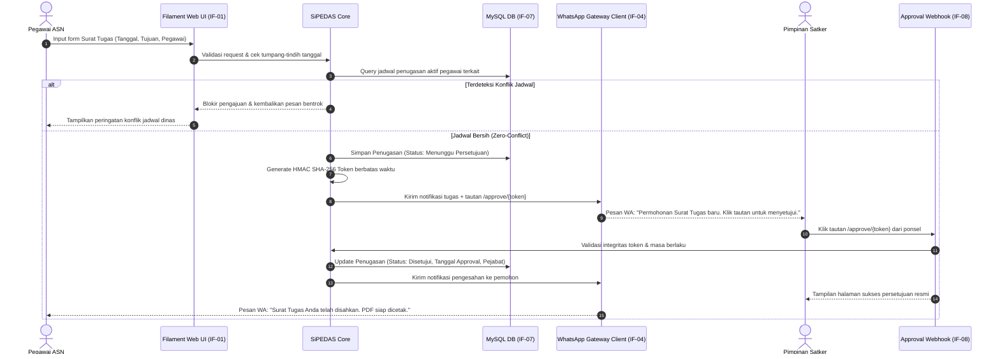
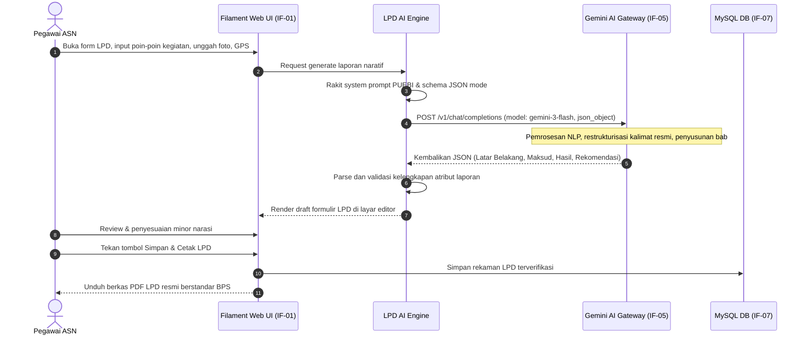
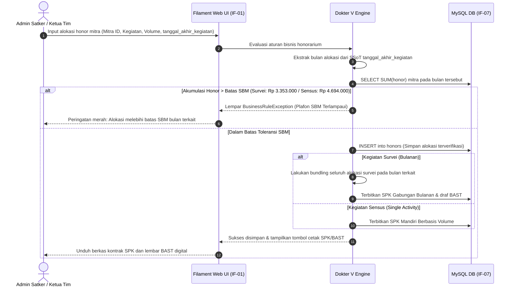
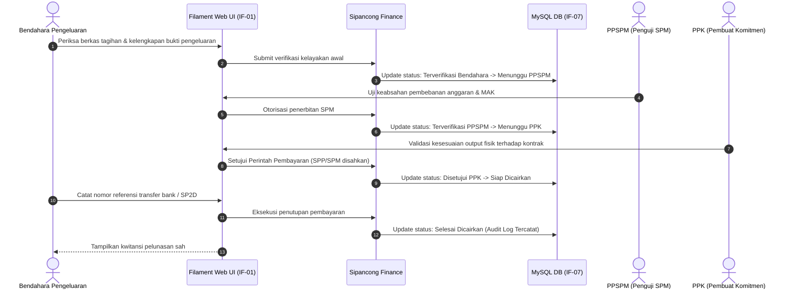

# 6. Tinjauan Runtime (Runtime View)

> [!INFO] **Architecture Provenance & Freshness**
> - **Verified Commit**: `9cc0f0e` (branch: `main`)
> - **Verified Timestamp**: `2026-10-27T18:56:09+07:00`
> - **Tracked Paths**: `app/`, `routes/`, `config/`, `database/`
> - **Drift Status**: `verified`

Seksi ini memvisualisasikan interaksi dinamis antar komponen sistem dan entitas eksternal selama eksekusi skenario bisnis kritis.

---

## 6.1 Skenario 1: Pengajuan Surat Tugas, Deteksi Bentrok & One-Click WhatsApp Approval

Skenario ini menggambarkan alur dari saat pegawai mengajukan surat tugas perjalanan dinas hingga pengesahan instan oleh pimpinan melalui tautan WhatsApp:

---

## 6.2 Skenario 2: Sintesis Laporan Perjalanan Dinas via LPD AI

Skenario penyusunan LPD otomatis dari catatan lapangan kasar menggunakan LLM Google Gemini:

---

## 6.3 Skenario 3: Verifikasi Honor Mitra Dokter V, Batas SBM & SPK/BAST

Alur pengalokasian honor mitra statistik dengan penegakan Single Source of Truth dan plafon SBM:

---

## 6.4 Skenario 4: Alur Verifikasi Keuangan Sipancong Multi-Tahap

Alur verifikasi pembayaran honorarium atau biaya perjalanan dinas oleh aparatur perbendaharaan:

