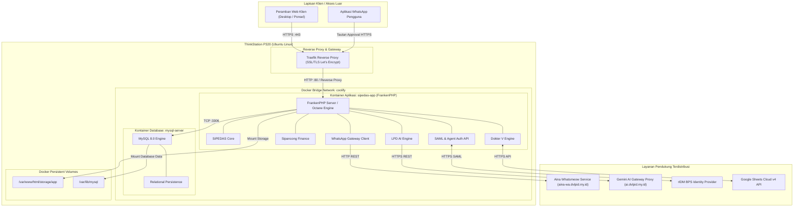

# 7. Tinjauan Penerapan / Deployment (Deployment View)

> [!INFO] **Architecture Provenance & Freshness**
> - **Verified Commit**: `9cc0f0e` (branch: `main`)
> - **Verified Timestamp**: `2026-10-27T18:56:09+07:00`
> - **Tracked Paths**: `app/`, `routes/`, `config/`, `database/`
> - **Drift Status**: `verified`

Seksi ini memetakan infrastruktur fisik, virtual, kontainerisasi, dan distribusi penempatan modul sistem SiPEDAS pada lingkungan produksi.

---

## 7.1 Infrastruktur Produksi (Production Infrastructure Overview)

Sistem SiPEDAS dikontainerisasi secara modern dan diorkestrasi melalui Coolify PaaS yang berjalan di atas server ThinkStation P320 pada klaster intranet/cloud BPS:

---

## 7.2 Pemetaan Komponen ke Node Infrastruktur (Building Block Deployment Coverage)

Tabel berikut menunjukkan pemetaan menyeluruh seluruh blok pembangun dari Seksi 5 ke node kontainer dan infrastruktur fisik (memenuhi syarat cakupan penerapan arsitektur):

| Building Block (Seksi 5) | Node Penerapan (Deployment Node) | Lingkungan Eksekusi & Konfigurasi |
|:---|:---|:---|
| **SiPEDAS Core** | `sipedas-app` (FrankenPHP Container) | Modul penugasan, cetak PDF, dan deteksi bentrok berjalan di dalam proses PHP 8.4 FrankenPHP worker mode di bawah alokasi memori kontainer 512MB. |
| **Dokter V Engine** | `sipedas-app` (FrankenPHP Container) | Layanan perhitungan honor, validasi SBM 2026, SPK, dan BAST dieksekusi di runtime aplikasi utama dengan sinkronisasi terjadwal. |
| **Sipancong Finance** | `sipedas-app` (FrankenPHP Container) | Subsistem verifikasi tagihan bertingkat dan audit trail keuangan berjalan di dalam kontainer web aplikasi. |
| **LPD AI Engine** | `sipedas-app` (FrankenPHP Container) | Klien orkestrasi LPD berjalan di kontainer aplikasi dan mendelegasikan komputasi berat AI ke `Gemini AI Gateway Proxy` eksternal. |
| **WhatsApp Gateway Client** | `sipedas-app` (FrankenPHP Container) | Pengirim pesan antrean dan pengelola opt-out terintegrasi di kontainer aplikasi dengan koneksi jaringan ke daemon `Aina Whatsmeow Service`. |
| **SAML & Agent Auth API** | `sipedas-app` (FrankenPHP Container) | Endpoint autentikasi SAML 2.0 dan REST API key guard dieksekusi langsung oleh route engine Laravel di kontainer aplikasi. |
| **Relational Persistence** | `mysql-server` (MySQL Container) | Skema database relasional disimpan dalam kontainer MySQL 8.0 dengan volume persisten host yang terlindungi pencadangan berkala (*automated WAL/dump backup*). |

---

## 7.3 Konfigurasi Sumber Daya & Jaringan (Resource Sizing & Network Policies)

| Node | Sumber Daya CPU | Batas RAM | Volume Disk | Kebijakan Jaringan |
|:---|:---|:---|:---|:---|
| **Traefik Reverse Proxy** | 0.5 Core | 256 MB | Ephemeral | Menerima port 80/443 publik, mengalihkan seluruh HTTP ke HTTPS secara otomatis. |
| **sipedas-app Container** | 2.0 Core | 1024 MB | 10 GB SSD Persistent | Terisolasi di jaringan internal Docker bridge, hanya menerima koneksi via Traefik. |
| **mysql-server Container** | 2.0 Core | 2048 MB | 50 GB SSD Persistent | Port 3306 tidak diekspos ke internet publik; hanya dapat diakses oleh kontainer aplikasi di jaringan bridge yang sama. |
| **Aina Whatsmeow Gateway** | 1.0 Core | 512 MB | 5 GB SSD Persistent | Berjalan di node terpisah dalam jaringan mesh intranet dengan autentikasi API token. |
