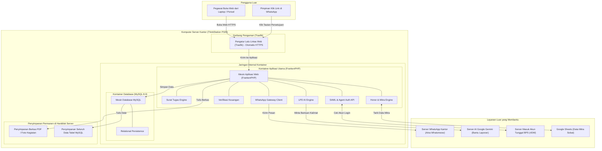

# 7. Tempat Berjalan Sistem (Deployment View)

> [!INFO] **Architecture Provenance & Freshness**
> - **Verified Commit**: `8765819` (branch: `main`)
> - **Verified Timestamp**: `2026-10-28T12:30:00+07:00`
> - **Tracked Paths**: `app/`, `routes/`, `config/`, `database/`
> - **Drift Status**: `verified`

Seksi ini menjelaskan di mana sistem Dokter-V dipasang, bagaimana komputer server kantor menjalankannya, dan bagaimana komponen aplikasi bekerja di lingkungan nyata.

---

## 7.1 Gambar Susunan Server Kantor

Sistem Dokter-V dijalankan di dalam server kantor ThinkStation P320 menggunakan teknologi wadah (*container Docker*) yang diatur otomatis melalui Coolify:

---

## 7.2 Di Mana Masing-Masing Bagian Dijalankan?

Tabel berikut menunjukkan di mana masing-masing bagian sistem dari Seksi 5 ditaruh dan dijalankan di server:

| Bagian Sistem (Seksi 5) | Dijalankan di Kontainer Mana? | Penjelasan Kerja di Lapangan |
|:---|:---|:---|
| **Surat Tugas Engine** | `dokterv-app` (Wadah Aplikasi FrankenPHP) | Mengatur surat tugas, mengecek jadwal bentrok, dan membuat nomor surat di dalam memori server agar prosesnya cepat. |
| **Honor & Mitra Engine** | `dokterv-app` (Wadah Aplikasi FrankenPHP) | Menghitung akumulasi honor mitra, memeriksa batas SBM, dan membuat berkas cetak kontrak SPK/BAST di server utama. |
| **Verifikasi Keuangan** | `dokterv-app` (Wadah Aplikasi FrankenPHP) | Mengatur tahapan persetujuan berkas tagihan belanja dinas dan honor mitra di server utama. |
| **LPD AI Engine** | `dokterv-app` (Wadah Aplikasi FrankenPHP) | Mengirimkan catatan lapangan ke server AI Google Gemini tanpa membuat server kantor menjadi berat atau panas. |
| **WhatsApp Gateway Client** | `dokterv-app` (Wadah Aplikasi FrankenPHP) | Mengirimkan pesan WhatsApp ke nomor HP tujuan dan mengalihkan ke jalur cadangan jika pengirim utama sedang bermasalah. |
| **SAML & Agent Auth API** | `dokterv-app` (Wadah Aplikasi FrankenPHP) | Menangani autentikasi login satu akun resmi BPS (rIDM) serta pintu masuk aman untuk program otomatis. |
| **Relational Persistence** | `mysql-server` (Wadah Database MySQL) | Menyimpan seluruh data tabel penugasan, nomor surat, dan pembayaran ke dalam harddisk server agar data tidak hilang. |

---

## 7.3 Kebutuhan Sumber Daya Server yang Ringan

Sistem dirancang hemat sumber daya sehingga komputer kantor standar sudah sangat cukup untuk menjalankannya dengan lancar:

| Bagian Server | Kebutuhan Prosesor (CPU) | Kebutuhan Memori (RAM) | Ukuran Penyimpanan | Catatan Keamanan |
|:---|:---|:---|:---|:---|
| **Pengatur Web (Traefik)** | Cukup 0.5 Inti | 256 MB | Sangat kecil (sementara) | Menjaga semua jalur masuk aman dengan enkripsi HTTPS resmi. |
| **Aplikasi Utama (dokterv-app)** | 1.0 – 2.0 Inti | 1024 MB (1 GB) | 10 GB SSD | Terisolasi di jaringan internal, hanya bisa diakses lewat jalur Traefik. |
| **Database (mysql-server)** | 1.0 – 2.0 Inti | 2048 MB (2 GB) | 50 GB SSD | Terkunci di dalam server, orang luar tidak bisa mengakses database secara langsung. |
| **Layanan WhatsApp (Aina)** | 0.5 – 1.0 Inti | 512 MB | 5 GB SSD | Menjaga koneksi WhatsApp kantor tetap stabil sepanjang hari. |
