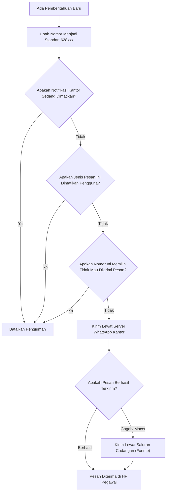

# 8. Konsep Perlindungan dan Keamanan Sistem (Cross-Cutting Concepts)

> [!INFO] **Architecture Provenance & Freshness**
> - **Verified Commit**: `4235153` (branch: `main`)
> - **Verified Timestamp**: `2026-10-28T12:30:00+07:00`
> - **Tracked Paths**: `app/`, `routes/`, `config/`, `database/`
> - **Drift Status**: `verified`

Seksi ini menjelaskan aturan-aturan penting yang berlaku menyeluruh di semua menu sistem, seperti keamanan akun, pembagian hak akses, keamanan penyimpanan data, dan penanganan pesan.

---

## 8.1 Cara Pengguna Masuk ke Sistem (Keamanan Akun)

```mermaid
graph TD
    Pengguna["Orang yang Ingin Akses"] --> Pilihan{"Cara Mengakses?"}
    Pilihan -->|Pegawai Buka Web (Mode SSO)| SAML["Login Satu Akun BPS (/saml/login)"]
    Pilihan -->|Pegawai Buka Web (Mode Lokal)| LocalLogin["Login Akun Email/Sandi (/a/login)"]
    Pilihan -->|Pengesah Lewat WhatsApp| TokenSign["Tautan Kriptografis Signed Route (/surat-tugas/quick-approve)"]
    Pilihan -->|Program Bot Otomatis| APIKey["Kunci Rahasia API (/v1/*)"]

    SAML --> rIDM["Dicek ke Akun Resmi BPS (rIDM)"]
    LocalLogin --> CekBcrypt["Dicek ke Tabel Pegawai (Bcrypt Hash)"]
    TokenSign --> CekToken["Validasi Tanda Tangan HMAC & Deteksi Bot"]
    APIKey --> CekKey["Pastikan Kunci Terdaftar"]

    rIDM --> MasukMenu["Masuk ke Menu Sesuai Jabatan"]
    CekBcrypt --> MasukMenu
    CekToken --> SahkanTugas["Langsung Sahkan Surat Tugas (1-Klik)"]
    CekKey --> BeriData["Berikan Data yang Diminta"]
```

1. **Masuk Satu Akun Resmi BPS (Single Sign-On / rIDM) & Akun Lokal**:
   - Jika `AUTH_MODE=sso_saml`: Pegawai masuk menggunakan email/NIP resmi BPS (rIDM SSO). Nama, jabatan, dan NIP otomatis disinkronkan ke sistem.
   - Jika `AUTH_MODE=email_password`: Untuk kantor yang belum terhubung ke SSO pusat, sistem menyediakan autentikasi lokal aman menggunakan kata sandi ter-hash (Bcrypt) dengan proteksi brute-force (rate limiter 5 percobaan).
2. **Tautan Persetujuan Kilat WhatsApp Bertanda Tangan Kriptografis (1-Click Signed Route)**:
   - Tautan persetujuan dibuat menggunakan mekanisme `URL::temporarySignedRoute` (HMAC SHA-256 terikat pada kunci rahasia aplikasi `APP_KEY`), berlaku selama 14 hari.
   - **Stateless & Efisien**: Tidak memerlukan tabel database token sementara. Menjamin `grup_id` dan `nip` pengesah tidak dapat dimanipulasi tanpa merusak tanda tangan digital.
   - **Pencegahan Bot/Crawler**: Sistem memeriksa header `User-Agent`. Jika permintaan berasal dari bot pembuat thumbnail (WhatsApp `facebookexternalhit/1.1`, Twitterbot, Googlebot), sistem hanya merespons dengan metadata OpenGraph tanpa mengubah status surat tugas. Persetujuan hanya tereksekusi saat diklik peramban nyata.
3. **Kunci API untuk Integrasi Otomatis**:
   - Jika ada bot atau program lain yang butuh data, akses hanya diberikan jika menyertakan kunci rahasia (*API Key*). Kunci ini disimpan dalam bentuk acak terenkripsi di database kantor.

---

## 8.2 Pembagian Wewenang Pengguna (Siapa Boleh Buka Apa?)

Agar administrasi tertib, setiap orang hanya bisa membuka menu sesuai tugas fungsinya di kantor:

| Peran Jabatan | Apa Saja yang Boleh Dilakukan? | Apa yang Tidak Boleh? |
|:---|:---|:---|
| **super_admin** | Mengatur aplikasi, mengelola akun pengguna, dan mencadangkan data. | Terbatas untuk pengelola teknis IT kantor. |
| **kepala_satker** | Menyetujui surat tugas dinas, menunjuk Pelaksana Harian (Plh), mengesahkan kontrak SPK mitra, dan melihat laporan dinas. | Tidak bisa mencatat bukti transfer uang bank. |
| **kasubbag_tu** | Memeriksa kelayakan administrasi tugas, mengecek ketersediaan pagu anggaran, dan mengesahkan penugasan jika ditunjuk sebagai Plh. | Penguji kelayakan persuratan awal. |
| **ppk** | Menandatangani kontrak kerja sama mitra (SPK), memastikan hasil kerja lapangan sudah selesai lewat BAST, dan menyetujui perintah bayar. | Pemegang komitmen keuangan dinas. |
| **ppspm** | Menguji kelayakan Surat Perintah Membayar (SPM) dan pembebanan anggaran negara. | Terpisah penuh dari bendahara pengeluaran. |
| **bendahara** | Memeriksa kuitansi, menghitung pajak PPh 21/23 mitra, dan mencatat nomor bukti transfer bank setelah dana cair. | Tidak bisa mengubah nominal honor yang sudah disepakati di awal. |
| **pegawai** | Mengajukan surat tugas untuk dirinya/timnya, membuat draf laporan dinas dibantu AI, dan memantau apakah tugasnya sudah disetujui pimpinan. | Hanya bisa melihat data tugas miliknya sendiri. |

---

## 8.3 Penyimpanan Data yang Aman dan Menyeluruh

1. **Penyimpanan Serempak (Semua Berhasil atau Semua Batal)**:
   - Saat membuat surat tugas, sistem harus menyimpan data tugas sekaligus mengambil nomor surat resmi berikutnya. Jika salah satu langkah gagal (misalnya koneksi terputus saat nomor surat diambil), sistem otomatis membatalkan seluruh proses agar nomor surat tidak terbuang atau meloncat.
2. **Mencegah Dua Orang Berebut Mitra yang Sama**:
   - Ketika ada admin yang sedang mengalokasikan honor pada seorang mitra, sistem mengunci data mitra tersebut sesaat selama proses simpan berlangsung. Ini mencegah dua admin secara tidak sengaja menginput honor untuk orang yang sama pada detik yang sama hingga melebihi batas SBM.

---

## 8.4 Penanganan Nomor Telepon dan Privasi Notifikasi

Pengiriman pesan otomatis ke nomor WhatsApp mematuhi aturan berikut:



---

## 8.5 Pembaruan Aplikasi Tanpa Menghapus Pengaturan Pengguna

Ketika pengembang memperbarui aplikasi atau memperbarui versi sistem di server:
- Sistem menggunakan perintah pembaruan yang cerdas (*updateOrCreate*).
- Pengaturan yang sudah diisi oleh pegawai (misalnya pengaturan mematikan notifikasi pesan tertentu) tetap terjaga aman dan **tidak akan terhapus** saat aplikasi diperbarui.

---

## 8.6 Pengelolaan Konfigurasi Multi-Satker (Invarian vs Varian)

Untuk memastikan sistem dapat diadopsi oleh satker BPS lain tanpa modifikasi kode inti:
1. **Pemisahan Logika Invarian**:
   - Seluruh aturan perhitungan SBM, alur surat tugas, siklus hidup verifikasi keuangan, dan deteksi bentrok bersifat universal dan tidak dimodifikasi antar-kantor.
2. **Pusat Konfigurasi Varian (`config/satker.php`)**:
   - Variabel `SATKER_KODE`, `SATKER_NAMA`, `SATKER_KABUPATEN`, dan daftar NIP pejabat definitif (Kepala, Kasubbag TU, PPK, Bendahara) diatur melalui environment variable dan file config.
3. **Data Master Terisolasi & Terstruktur**:
   - Impor data pegawai, mitra, dan wilayah SLS menggunakan template CSV standar di `storage/app/templates/` yang dieksekusi melalui artisan command `satker:import-all`.
