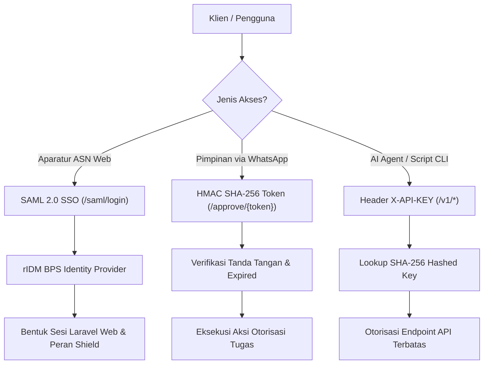
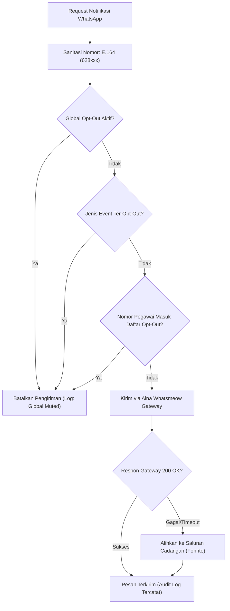

# 8. Konsep Lintas Komponen (Cross-Cutting Concepts)

> [!INFO] **Architecture Provenance & Freshness**
> - **Verified Commit**: `9cc0f0e` (branch: `main`)
> - **Verified Timestamp**: `2026-10-27T18:56:09+07:00`
> - **Tracked Paths**: `app/`, `routes/`, `config/`, `database/`
> - **Drift Status**: `verified`

Seksi ini menguraikan arsitektur dan pola penanganan aspek-aspek yang melintasi berbagai subsistem (*cross-cutting concerns*) dalam platform SiPEDAS.

---

## 8.1 Keamanan & Autentikasi Terintegrasi (Security & Authentication)



1. **SAML 2.0 Single Sign-On (rIDM Integration)**:
   - Akses web aparatur BPS dialihkan ke penyedia identitas tunggal rIDM (`/saml/*`) dengan protokol SAML 2.0 HTTP-POST binding.
   - Sesi terenkripsi, sinkronisasi NIP dan nama pegawai otomatis saat *login claim*, dan logout terkoordinasi (*Single Logout*).
2. **One-Click Signed Approval Tokens**:
   - Tautan otorisasi persetujuan surat tugas dibuat menggunakan token yang ditandatangani secara kriptografis (`hash_hmac('sha256', ...)`) dengan masa kedaluwarsa ketat (7 hari).
   - Mencegah manipulasi URL (*tampering*); sekali digunakan, token langsung hangus (*one-time use* / idempotent).
3. **Agent-Native API Key Guard**:
   - Akses terprogram untuk agen AI atau skrip otomatisasi menggunakan header `X-API-KEY`. Kunci disimpan dalam database dalam format ter-hash SHA-256, membatasi lingkup akses hanya pada modul yang diizinkan.

---

## 8.2 Otorisasi & Kontrol Akses Berbasis Peran (RBAC via Filament Shield)

Sistem menggunakan matriks peran (Role-Based Access Control) yang ditegakkan di level navigasi, formulir, dan query database:

| Peran | Ruang Lingkup Otorisasi | Batasan Akses |
|:---|:---|:---|
| **super_admin** | Akses penuh seluruh modul, konfigurasi sistem, dan manajemen hak akses. | Hak superuser terbatas untuk pengelola IT. |
| **kepala_satker** | Otorisasi surat tugas, penetapan Plh, pengesahan SPK mitra, dan tinjauan LPD. | Tidak dapat mengubah data bukti transfer bank. |
| **kasubbag_tu** | Verifikasi administrasi surat tugas, validasi ketersediaan MAK, dan delegasi Plh. | Penguji administrasi awal. |
| **ppk** | Pengesahan SPK, validasi kesesuaian output mitra terhadap BAST, dan persetujuan bayar. | Pemegang komitmen keuangan negara. |
| **ppspm** | Pengujian Surat Perintah Membayar (SPM) dan pembebanan akun anggaran. | Independen dari fungsi bendahara pengeluaran. |
| **bendahara** | Pencatatan verifikasi tagihan, pemotongan pajak PPh 21/23, dan pencatatan nomor SP2D/transfer. | Tidak dapat mengubah nominal alokasi honor. |
| **pegawai** | Pengajuan surat tugas mandiri, pelaporan draft LPD AI, dan pemantauan status persetujuan. | Terisolasi hanya pada penugasan dirinya sendiri. |

---

## 8.3 Manajemen Transaksi & Konsistensi Data (Transaction & Locking)

1. **ACID Transaction Boundary**:
   - Seluruh mutasi yang melibatkan multi-tabel (misalnya: penomoran surat tugas otomatis, kalkulasi bundling SPK survei, dan persetujuan pembayaran) wajib dijalankan di dalam blok penutupan:
     ```php
     DB::transaction(function () {
         // Evaluasi SBM, penguncian baris, dan penulisan berkas
     });
     ```
2. **Pessimistic Concurrency Locking**:
   - Pada saat verifikasi alokasi honor mitra, sistem melakukan query dengan klausa `lockForUpdate()` pada baris akumulasi honor mitra bulan berjalan. Hal ini mencegah dua admin satker memasukkan kegiatan berbeda secara bersamaan yang dapat menyebabkan total honor melompati plafon SBM (*race condition*).

---

## 8.4 Normalisasi Nomor Telepon & Hierarki Opt-Out WhatsApp

Pengiriman pesan transaksional melalui `WhatsappNotifier` mematuhi aturan sanitasi nomor dan privasi:



---

## 8.5 Idempotent Seeding & Pelestarian Konfigurasi Produksi

Untuk mencegah hilangnya data konfigurasi pengguna (seperti pengaturan opt-out notifikasi) saat redeploy di server Coolify:
- Seluruh database seeder dilarang keras menggunakan metode destruktif seperti `truncate()` atau `delete()`.
- Seeder wajib menggunakan pola idempotensi berbasis kunci unik:
  ```php
  WhatsappOptOut::updateOrCreate(
      ['user_id' => $user->id, 'channel' => 'honor_payment'],
      ['is_active' => true]
  );
  ```
- Menjamin data kustomisasi pengguna di lingkungan produksi tetap utuh setelah migrasi dan seeder otomatis dijalankan.
