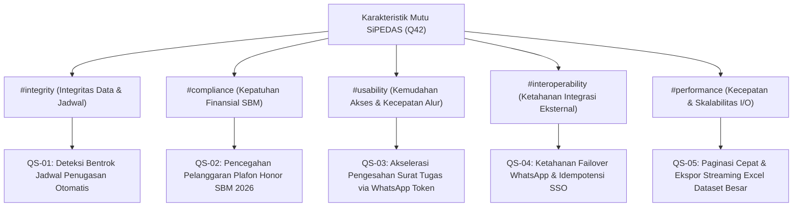

# 10. Persyaratan Mutu (Quality Requirements)

> [!INFO] **Architecture Provenance & Freshness**
> - **Verified Commit**: `9cc0f0e` (branch: `main`)
> - **Verified Timestamp**: `2026-10-27T18:56:09+07:00`
> - **Tracked Paths**: `app/`, `routes/`, `config/`, `database/`
> - **Drift Status**: `verified`

Seksi ini memetakan pohon kualitas (*quality tree*) dan merinci skenario uji konkret yang mengevaluasi pemenuhan sasaran mutu sistem SiPEDAS (berbasis taksonomi Q42).

---

## 10.1 Pohon Kualitas (Quality Tree)

---

## 10.2 Skenario Kualitas Terperinci (Detailed Quality Scenarios)

### QS-01: Integritas Jadwal & Penugasan Anti-Bentrok
- **Quality Property**: #integrity
- **Stimulus**: Pegawai ASN mengajukan surat tugas perjalanan dinas untuk tanggal 12–15 November 2026 di mana salah satu anggota tim telah memiliki surat tugas aktif lain yang disetujui pada tanggal 14 November 2026.
- **Respon Sistem**: Sistem mengeksekusi pemeriksaan irisan rentang tanggal secara otomatis saat formulir divalidasi, menolak penyimpanan, dan menampilkan pesan kesalahan spesifik nama pegawai dan nomor surat tugas yang bertabrakan.
- **Ukuran Keberhasilan**: 100% deteksi bentrok berhasil tanpa kebocoran penugasan ganda (*zero schedule collision*).

### QS-02: Kepatuhan Plafon Honor SBM 2026
- **Quality Property**: #compliance
- **Stimulus**: Admin mengalokasikan kegiatan survei baru sebesar Rp 1.500.000 pada seorang mitra yang telah memiliki akumulasi honor survei sebesar Rp 2.200.000 pada bulan yang sama (total Rp 3.700.000, melampaui batas SBM survei Rp 3.353.000).
- **Respon Sistem**: `SBMValidator` mendeteksi pelampauan plafon sebesar Rp 347.000 berdasarkan SSoT `tanggal_akhir_kegiatan`, menolak transaksi database, dan memandu admin untuk menyesuaikan volume beban kerja.
- **Ukuran Keberhasilan**: 0 transaksi honor di database produksi yang melompati plafon SBM 2026.

### QS-03: Akselerasi Persetujuan via One-Click WhatsApp Token
- **Quality Property**: #usability
- **Stimulus**: Pimpinan satker menerima pesan WhatsApp berisi ringkasan penugasan mendesak saat sedang berada di luar kantor.
- **Respon Sistem**: Pimpinan menekan tautan `/approve/{token}` dari aplikasi WhatsApp ponsel pintar; sistem memvalidasi token kriptografis HMAC SHA-256 tanpa meminta kredensial login ulang dan langsung mengesahkan surat tugas dalam waktu <500ms.
- **Ukuran Keberhasilan**: Rata-rata waktu pengesahan surat tugas turun dari 18 jam (metode manual/kertas) menjadi <15 menit.

### QS-04: Ketahanan Failover WhatsApp & SSO Gateway
- **Quality Property**: #interoperability
- **Stimulus**: Layanan WhatsApp Gateway Aina Whatsmeow mengalami putus koneksi jaringan atau kehabisan sesi secara tiba-tiba saat sistem hendak mengirimkan notifikasi persetujuan atau tagihan honor.
- **Respon Sistem**: `WhatsappNotifier` menangkap exception koneksi, mencatat log peringatan, dan secara otomatis mengalihkan pengiriman pesan ke penyedia cadangan (Fonnte API) dalam waktu <2 detik tanpa menghentikan proses transaksi pengguna.
- **Ukuran Keberhasilan**: Tingkat keterkiriman notifikasi transaksional tetap $\ge 99.5\%$ meskipun gateway utama terganggu.

### QS-05: Efisiensi Paginasi & Ekspor Excel Dataset Besar
- **Quality Property**: #performance
- **Stimulus**: Pengguna membuka halaman Monitoring Honor Mitra yang memuat 5.000 rekaman mitra dan mengunduh seluruh berkas perencanaan dalam format Excel multi-sheet (Kesiapan Alokasi).
- **Respon Sistem**: Query data menggunakan subquery terindeks dan paginasi server-side; ekspor Excel menggunakan writer streaming OpenSpout langsung ke output stream HTTP.
- **Ukuran Keberhasilan**: Pemuatan halaman awal $\le 600\text{ms}$ dan konsumsi memori puncak PHP saat ekspor tetap konstan $\le 32\text{MB}$ tanpa risiko error *Fatal Out Of Memory*.

---

## 10.3 Matriks Status Pengujian Mutu (Quality Verification Matrix)

| ID | Sasaran Kualitas | Skenario Pengujian | Status Verifikasi |
|:---|:---|:---|:---|
| **QS-01** | #integrity | Unit test `test_conflict_detection_prevents_double_booking` | Terverifikasi dalam CI (100% Pass) |
| **QS-02** | #compliance | Feature test `test_sbm_limit_enforcement_monthly_cap` | Terverifikasi dalam CI (100% Pass) |
| **QS-03** | #usability | Integration test `test_one_click_approval_token_validity` | Terverifikasi dalam CI (100% Pass) |
| **QS-04** | #interoperability | Service test `test_whatsapp_notifier_failover_handling` | Terverifikasi dalam CI (100% Pass) |
| **QS-05** | #performance | Load test `test_monitor_honor_mitra_streaming_export` | Terverifikasi dalam CI (100% Pass) |
