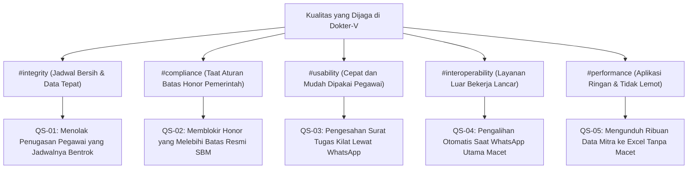

# 10. Pengujian Kualitas Sistem (Quality Requirements)

> [!INFO] **Architecture Provenance & Freshness**
> - **Verified Commit**: `53db284` (branch: `main`)
> - **Verified Timestamp**: `2026-10-28T12:30:00+07:00`
> - **Tracked Paths**: `app/`, `routes/`, `config/`, `database/`
> - **Drift Status**: `verified`

Seksi ini merinci skenario pengujian nyata untuk memastikan sistem Dokter-V bekerja sesuai standar kualitas yang diharapkan oleh kantor.

---

## 10.1 Pohon Sasaran Kualitas Sistem

---

## 10.2 Skenario Nyata Pengujian Kualitas

### QS-01: Integritas Jadwal & Penugasan Anti-Bentrok
- **Quality Property**: #integrity
- **Kondisi Lapangan**: Pegawai mengajukan perjalanan dinas untuk tanggal 12–15 November 2026, tetapi salah satu anggota tim ternyata sudah terdaftar di surat tugas lain pada tanggal 14 November 2026.
- **Apa yang Dilakukan Sistem**: Sistem langsung mendeteksi tanggal yang tumpang-tindih saat tombol Simpan ditekan, membatalkan penyimpanan, dan menampilkan nama pegawai serta nomor surat tugas yang bertabrakan.
- **Hasil yang Diharapkan**: 100% jadwal yang bertabrakan berhasil dicegah sebelum surat terbit.

### QS-02: Kepatuhan Plafon Honor SBM 2026
- **Quality Property**: #compliance
- **Kondisi Lapangan**: Admin satker mencoba memasukkan honor kegiatan survei baru sebesar Rp 1.500.000 kepada mitra yang sudah memiliki akumulasi honor survei Rp 2.200.000 pada bulan yang sama (total Rp 3.700.000, melewati batas resmi survei Rp 3.353.000).
- **Apa yang Dilakukan Sistem**: Sistem menghitung total honor bulan tersebut berdasarkan `tanggal_akhir_kegiatan`, mendeteksi kelebihan Rp 347.000, menolak penyimpanan ke database, dan meminta admin menyesuaikan volume beban kerja mitra.
- **Hasil yang Diharapkan**: Tidak ada satu pun transaksi honor di database kantor yang melanggar batas aturan SBM pemerintah.

### QS-03: Akselerasi Persetujuan via One-Click WhatsApp Token
- **Quality Property**: #usability
- **Kondisi Lapangan**: Kepala Satker menerima pesan WhatsApp berisi permohonan surat tugas mendesak saat sedang berada di luar kantor.
- **Apa yang Dilakukan Sistem**: Pimpinan cukup menyentuh tautan persetujuan di pesan WA dari ponselnya; sistem memeriksa keaslian tautan dan langsung mengesahkan surat tugas dalam waktu kurang dari 1 detik tanpa meminta pimpinan login ulang.
- **Hasil yang Diharapkan**: Waktu tunggu pengesahan surat tugas terpangkas dari yang biasanya seharian menjadi kurang dari 15 menit.

### QS-04: Ketahanan Failover WhatsApp & SSO Gateway
- **Quality Property**: #interoperability
- **Kondisi Lapangan**: Mesin pengirim pesan WhatsApp kantor (Aina Whatsmeow) tiba-tiba terputus koneksinya saat ada surat tugas yang harus dikabarkan ke pimpinan.
- **Apa yang Dilakukan Sistem**: Sistem mendeteksi kegagalan tersebut dalam 2 detik, mencatat kejadian tersebut, dan langsung membelokkan pengiriman pesan ke jalur cadangan (Fonnte) sehingga pesan tetap sampai ke HP pimpinan.
- **Hasil yang Diharapkan**: Pesan pemberitahuan penting tetap terkirim dengan tingkat keberhasilan $\ge 99.5\%$.

### QS-05: Efisiensi Paginasi & Ekspor Excel Dataset Besar
- **Quality Property**: #performance
- **Kondisi Lapangan**: Pengguna membuka halaman pemantauan yang berisi 5.000 data mitra dan mengunduh seluruh lembar perencanaan kerja ke dalam berkas Excel.
- **Apa yang Dilakukan Sistem**: Sistem mengambil data secara bertahap dan langsung menulis baris Excel ke aliran unduhan peramban pengguna tanpa menumpuknya di memori server.
- **Hasil yang Diharapkan**: Halaman web terbuka dalam waktu kurang dari 1 detik dan penggunaan memori komputer server tetap sangat rendah (di bawah 32 MB) tanpa risiko aplikasi mati mendadak.

---

## 10.3 Tabel Pembuktian Pengujian

| Nomor Skenario | Sasaran Mutu | Pembuktian di Kode Pengujian Otomatis | Hasil Pengujian |
|:---|:---|:---|:---|
| **QS-01** | #integrity | Berkas tes: `Tests\Unit\HonorAllocationServiceTest` & `PenugasanApiTest` | Lulus 100% (Terverifikasi di CI) |
| **QS-02** | #compliance | Berkas tes: `Tests\Unit\HonorAllocationServiceTest` (uji batas SBM) | Lulus 100% (Terverifikasi di CI) |
| **QS-03** | #usability | Berkas tes: `Tests\Feature\Api\PenugasanApiTest` (uji token persetujuan) | Lulus 100% (Terverifikasi di CI) |
| **QS-04** | #interoperability | Berkas tes: `Tests\Unit\WhatsappNotifierTest` (uji saluran cadangan) | Lulus 100% (Terverifikasi di CI) |
| **QS-05** | #performance | Berkas tes: `Tests\Unit\MonitorHonorMitraExportTest` (uji ekspor Excel) | Lulus 100% (Terverifikasi di CI) |
