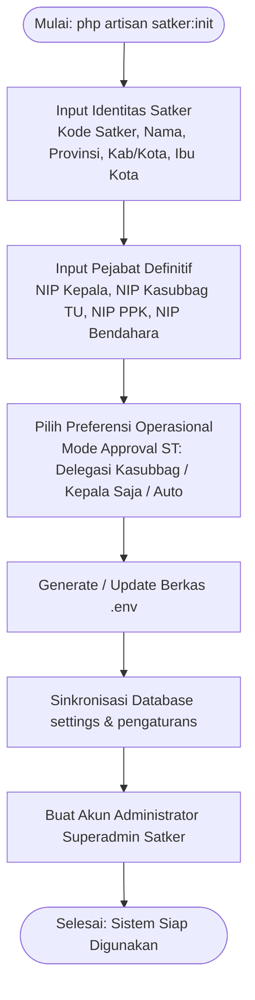

# 04. Interactive CLI Setup Wizard (`php artisan satker:init`)

> [!INFO] **Metadata Modul**
> - **Kode Rencana**: `PLN-P02-04`
> - **Fase**: 2 (Generalisasi Framework Multi-Satker)
> - **Tingkat Prioritas**: P1 (Penting)
> - **Induk**: [02. Rencana Pelaksanaan Fase 2](README.md)

---

## 1. Sasaran Modul
Menyediakan perintah antarmuka baris perintah (*Command-Line Interface* / CLI) interaktif `satker:init` yang memandu pengembang di satker lain untuk mengonfigurasi Dokter-V secara mandiri dalam waktu kurang dari 3 menit tanpa perlu menyunting berkas kode atau database secara manual.

---

## 2. Masalah yang Diselesaikan
Bagi pengembang baru di satker lain, melakukan setup aplikasi yang memiliki banyak parameter (kode satker, NIP kepala, NIP PPK, NIP bendahara, level instansi, nama kabupaten) sangat rawan terjadi *human error* jika dilakukan dengan mengedit file `.env` dan mengisi puluhan baris database tabel `pengaturans` secara manual.

---

## 3. Spesifikasi Teknis

### 3.1 Perintah Artisan
- **Signature**: `php artisan satker:init {--non-interactive} {--force}`
- **Handler Class**: `App\Console\Commands\SatkerInitCommand`

### 3.2 Diagram Alur Wizard Interaktif



### 3.3 Pertanyaan Interaktif (Interactive Prompts)
1. **Kode Satker 4 Digit**: Validasi numerik 4 digit (misal: `3204`).
2. **Nama Satker**: String nama instansi (default: `"BPS Kabupaten [Nama]"`).
3. **Level Satuan Kerja**: Pilihan `[KAKO]` atau `[PROVINSI]`.
4. **Nama Kabupaten/Kota**: String nama wilayah (misal: `"Kabupaten Bandung"`).
5. **Ibu Kota / Kota Kedudukan**: String nama kota kedudukan kantor (misal: `"Soreang"`).
6. **Nama Provinsi**: String nama provinsi (misal: `"Jawa Barat"`).
7. **Email Resmi Satker**: Format email instansi (misal: `"bps3204@bps.go.id"`).
8. **NIP 4 Pejabat Utama**: NIP Kepala, Kasubbag TU, PPK, dan Bendahara Pengeluaran (validasi 18 digit NIP BPS).
9. **Mode Persetujuan Surat Tugas**: Pilihan mode (`delegasi_ppspm`, `kepala_only`, `ppspm_only`, `auto_approve`).

### 3.4 Tindakan Otomatis yang Dilakukan Command
1. Membaca atau membuat berkas `.env` lokal, menyuntikkan seluruh variabel `SATKER_*`.
2. Menyimpan/memperbarui rekaman di tabel `pengaturans` dan `settings`.
3. Menyesuaikan format nomor surat default ke kode satker yang baru (`SATKER_KODE_SURAT`).
4. Membuat akun user administrator default jika belum ada (Role: `super_admin`).
5. Menjalankan `php artisan optimize:clear` untuk memastikan cache konfigurasi bersih.

---

## 4. Kriteria Keberhasilan (Acceptance Criteria)
1. Perintah dapat dijalankan pada repositori yang baru di-clone:
   ```bash
   cp .env.example .env
   php artisan key:generate
   php artisan migrate
   php artisan satker:init
   ```
2. Aplikasi langsung menampilkan identitas satker yang diinputkan tanpa ada sisa identitas Mempawah.
3. Command bersifat *idempotent* (aman dijalankan ulang untuk memperbarui profil satker sewaktu-waktu).
