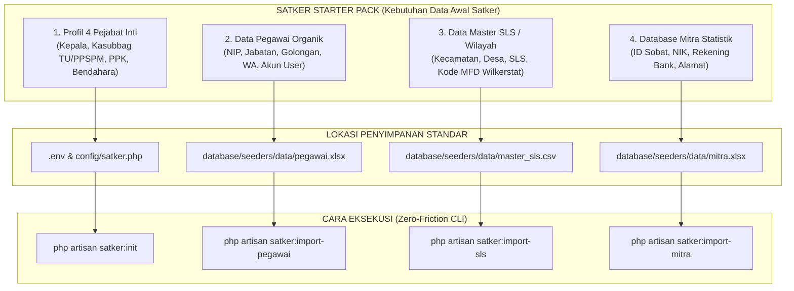

# 05. Scaffolding Starter Pack: Data Pejabat, Pegawai, Mitra, & Master SLS

> [!INFO] **Metadata Modul**
> - **Kode Rencana**: `PLN-P02-05`
> - **Fase**: 2 (Generalisasi Framework Multi-Satker)
> - **Tingkat Prioritas**: P0 (Kritis)
> - **Induk**: [02. Rencana Pelaksanaan Fase 2](../02_satker_framework_generalization.md)

---

## 1. Sasaran Modul
Menyediakan panduan praktis dan scaffolding berkas data awal (*Satker Starter Pack*) bagi pengembang di satker lain. Modul ini menjawab 4 pertanyaan mendasar pengembang:
1. **File apa saja yang harus disiapkan?**
2. **Seperti apa template dan format kolomnya?**
3. **Di mana berkas tersebut harus diletakkan (*path directory*)?**
4. **Perintah apa yang harus dijalankan untuk memprosesnya (*CLI command*)?**

---

## 2. Empat Pilar Data Awal Satker (The 4 Starter Pack Files)

Setiap Satker BPS Kabupaten/Kota membutuhkan 4 kelompok data master agar seluruh fitur Dokter-V dapat beroperasi penuh:



---

## 3. Rincian Template, Lokasi, dan Cara Eksekusi

---

### 3.1 Berkas 1: Profil Pejabat Definitif Inti Satker

Pejabat inti merupakan pemegang kewenangan hukum (*statutory authority*) dalam pencairan anggaran negara dan penerbitan surat tugas BPS:

| Peran Sistem | Jabatan Formal di BPS Kab/Kota | Kewenangan dalam Dokter-V | Role Spatie |
|:---|:---|:---|:---|
| **Kepala Satker** | Kepala BPS Kabupaten/Kota (KPA) | Otoritas tertinggi penandatangan Surat Tugas & SPPD | `kepala_satker` |
| **Kasubbag TU** | Kepala Subbagian Umum / Tata Usaha | Penguji SPM (PPSPM), delegasi approval Surat Tugas, dan Plh default | `ppspm` |
| **PPK** | Pejabat Pembuat Komitmen | Penandatangan Kontrak (SPK), BAST, dan verifikasi akhir pembayaran Sipancong | `ppk` |
| **Bendahara** | Bendahara Pengeluaran | Verifikator berkas awal di Sipancong dan pemegang kas pencairan | `bendahara` |

#### A. Format & Lokasi Penyimpanan:
Dikonfigurasi melalui environment `.env` atau berkas [`config/satker.php`](file:///home/ihza/Projects/sipedas/config/satker.php):
```env
# Path: .env (di root repositori)
SATKER_KODE=3204
SATKER_NAMA="BPS Kabupaten Bandung"
SATKER_KABKOT="Kabupaten Bandung"
SATKER_PROVINSI="Jawa Barat"
SATKER_IBUKOTA="Soreang"

# NIP 4 Pejabat Inti Satker
SATKER_NIP_KEPALA=197501011998031001
SATKER_NIP_KASUBBAG=198205122006042002
SATKER_NIP_PPK=199003152014021003
SATKER_NIP_BENDAHARA=199508202018012004
```

#### B. Cara Eksekusi:
Cukup jalankan wizard interaktif:
```bash
php artisan satker:init
```
Perintah ini akan otomatis:
1. Menyimpan NIP ke `.env` dan tabel database `pengaturans`.
2. Menghubungkan NIP dengan akun `User` pegawai terkait.
3. Memberikan Spatie Role yang tepat (`kepala_satker`, `ppspm`, `ppk`, `bendahara`).

---

### 3.2 Berkas 2: Data Master SLS (Satuan Lingkungan Setempat)

Master SLS adalah referensi wilayah mikro (RT/RW/Dusun/Lingkungan) yang menjadi dasar penugasan survei dan sensus di BPS.

#### A. Lokasi Penyimpanan Berkas:
```text
database/seeders/data/master_sls.csv
```
*(Atau diunggah melalui menu Admin: Master Wilayah $\rightarrow$ Import SLS)*.

#### B. Template & Format Kolom (`master_sls.csv`):
Berkas ini berformat **CSV (Comma-Separated Values)** standar ekspor Master Fasilitas Desa (MFD Online) atau Wilkerstat BPS:

| Indeks Kolom | Nama Kolom | Tipe Data | Contoh Data | Deskripsi |
|:---:|:---|:---|:---|:---|
| 0 | `desa_kel_id` | String (10) | `3204080001` | Kode Wilayah Desa/Kelurahan BPS |
| 1 | `kec_id` | String (7) | `3204080` | Kode Wilayah Kecamatan BPS |
| 2 | `kabkot_id` | String (4) | `3204` | Kode Satker / Kabupaten BPS |
| 3 | `prov_id` | String (2) | `32` | Kode Provinsi BPS |
| 4 | `sls_id` | String (14) | `32040800010001` | Kode SLS Unik 14 Digit |
| 5 | `provinsi` | String | `JAWA BARAT` | Nama Provinsi |
| 6 | `kabkot` | String | `BANDUNG` | Nama Kabupaten/Kota |
| 7 | `kecamatan` | String | `SOREANG` | Nama Kecamatan |
| 8 | `desa_kel` | String | `PAMEUNTASAN` | Nama Desa atau Kelurahan |
| 9 | `nama` | String | `RT 001 RW 002` | Nama Satuan Lingkungan Setempat (SLS) |

**Contoh 2 Baris Pertama Berkas `master_sls.csv`:**
```csv
desa_kel_id,kec_id,kabkot_id,prov_id,sls_id,provinsi,kabkot,kecamatan,desa_kel,nama
3204080001,3204080,3204,32,32040800010001,JAWA BARAT,BANDUNG,SOREANG,PAMEUNTASAN,RT 001 RW 001
3204080001,3204080,3204,32,32040800010002,JAWA BARAT,BANDUNG,SOREANG,PAMEUNTASAN,RT 002 RW 001
```

#### C. Cara Eksekusi:
```bash
php artisan satker:import-sls database/seeders/data/master_sls.csv
```
*(Atau dijalankan saat database seed: `php artisan db:seed --class=MasterSlsSeeder`)*.

---

### 3.3 Berkas 3: Data Pegawai Organik Satker

Data seluruh ASN (PNS & PPPK) di lingkungan kantor BPS Kabupaten/Kota.

#### A. Lokasi Penyimpanan Berkas:
```text
database/seeders/data/pegawai.xlsx   (atau .csv)
```

#### B. Template & Format Kolom (`pegawai.xlsx`):

| Nama Kolom | Tipe | Contoh Isi | Keterangan |
|:---|:---|:---|:---|
| `nip` | String (18) | `198503122008011002` | NIP 18 Digit Pegawai (Wajib & Unik) |
| `nama` | String | `Ahmad Fauzi` | Nama lengkap tanpa gelar |
| `gelar_depan` | String | `Dr.` | Gelar depan (opsional) |
| `gelar_belakang` | String | `S.Si., M.Stat.` | Gelar belakang (opsional) |
| `pangkat` | String | `Penata / III.c` | Pangkat dan Golongan ruang |
| `jabatan` | String | `Statistisi Ahli Muda` | Jabatan fungsional atau struktural |
| `email` | String | `ahmad.fauzi@bps.go.id` | Email resmi akun SSO BPS |
| `nomor_wa` | String | `081234567890` | Nomor WhatsApp aktif untuk notifikasi |
| `role` | String | `pegawai` | Peran khusus: `kepala_satker`, `ppspm`, `ppk`, `bendahara`, atau `pegawai` |

#### C. Cara Eksekusi:
```bash
php artisan satker:import-pegawai database/seeders/data/pegawai.xlsx --create-users
```
> [!TIP]
> Flag `--create-users` secara otomatis membuatkan akun user login Dokter-V untuk setiap pegawai dengan role yang sesuai dan mengizinkan login via SSO BPS (SAML).

---

### 3.4 Berkas 4: Database Mitra Statistik Lokal

Data mitra pencacah lapangan dan pengawas statistik yang bekerja sama dengan kantor BPS.

#### A. Lokasi Penyimpanan Berkas:
```text
database/seeders/data/mitra.xlsx   (atau .csv)
```

#### B. Template & Format Kolom (`mitra.xlsx`):

| Nama Kolom | Tipe | Contoh Isi | Keterangan |
|:---|:---|:---|:---|
| `id_sobat` | String (8-10) | `32041001` | ID akun portal SOBAT BPS Mitra |
| `nik` | String (16) | `3204081205920003` | NIK KTP Mitra (Wajib 16 digit valid) |
| `nama` | String | `Siti Rahmawati` | Nama lengkap mitra sesuai KTP |
| `alamat` | String | `Kp. Sukamaju RT 02 RW 05` | Alamat tempat tinggal |
| `kecamatan` | String | `Soreang` | Kecamatan domisili |
| `desa_kelurahan` | String | `Pameuntasan` | Desa/Kelurahan domisili |
| `nomor_wa` | String | `085678901234` | Nomor WA aktif untuk pengiriman SPK/kontrak |
| `nama_bank` | String | `BRI` | Bank rekening pembayaran honor |
| `nomor_rekening` | String | `012301098765501` | Nomor rekening mitra |
| `nama_rekening` | String | `SITI RAHMAWATI` | Nama pemilik rekening buku tabungan |

#### C. Cara Eksekusi:
```bash
php artisan satker:import-mitra database/seeders/data/mitra.xlsx
```

---

## 4. Alur Kerja Praktis Pengembang Baru (Developer Workflow Summary)

Bagi pengembang dari Satker baru (misal BPS Kab. Bandung), langkah operasionalnya adalah:

```bash
# Langkah 1: Siapkan 3 berkas template di folder database/seeders/data/
# - database/seeders/data/master_sls.csv
# - database/seeders/data/pegawai.xlsx
# - database/seeders/data/mitra.xlsx

# Langkah 2: Jalankan wizard satker init
php artisan satker:init

# Langkah 3: Impor seluruh data dalam satu langkah
php artisan satker:import-all

# Langkah 4: Selesai! Seluruh data wilayah, pegawai, pejabat, dan mitra siap digunakan.
```

---

## 5. Kriteria Keberhasilan (Acceptance Criteria)
1. Seluruh 4 berkas memiliki template unduhan siap pakai (*dummy starter kit*) yang disertakan di repositori.
2. Perintah `php artisan satker:import-all` dapat mengeksekusi impor keempat berkas secara berurutan dengan penanganan error (*rollback on critical failure*).
3. Tidak ada dependensi data Mempawah yang tertinggal saat satker baru mengimpor data mereka.
