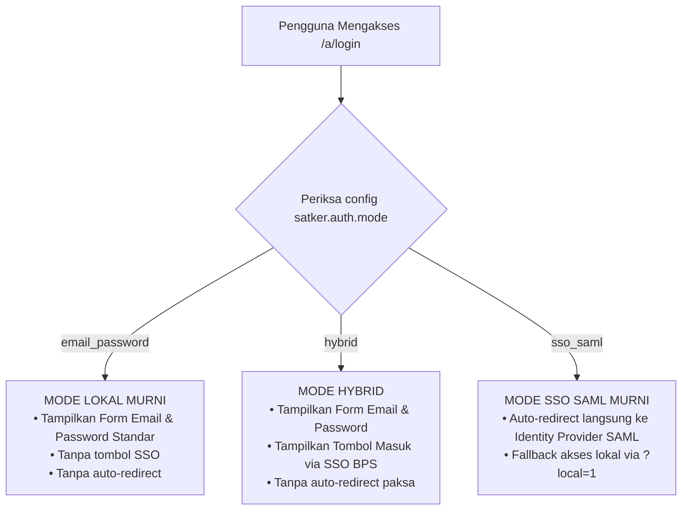

# 11. Fleksibilitas Autentikasi: Mode Lokal (Email/Password), SSO SAML, dan Hybrid

> [!INFO] **Metadata Modul**
> - **Kode Rencana**: `PLN-P02-11`
> - **Fase**: 2 (Generalisasi Framework Multi-Satker)
> - **Tingkat Prioritas**: P0 (Kritis)
> - **Induk**: [02. Rencana Pelaksanaan Fase 2](README.md)

---

## 1. Sasaran Modul
Menghilangkan ketergantungan mutlak pada server Single Sign-On (SSO SAML 2.0 rIDM BPS) dan memberikan kebebasan bagi setiap Satuan Kerja untuk memilih metode autentikasi yang paling sesuai dengan kesiapan infrastruktur IT kantor mereka:
1. **Mode Lokal Murni (`email_password`)**: Menggunakan email BPS dan password database lokal (cocok untuk satker tanpa server SSO).
2. **Mode SSO Murni (`sso_saml`)**: Auto-redirect langsung ke Identity Provider SAML 2.0 (seperti yang digunakan BPS Mempawah saat ini).
3. **Mode Campuran (`hybrid`)**: Menampilkan formulir email & password sekaligus opsi tombol login SSO BPS.

---

## 2. Masalah yang Diselesaikan
Pada implementasi saat ini di [`app/Filament/Pages/Auth/Login.php`](file:///home/ihza/Projects/sipedas/app/Filament/Pages/Auth/Login.php):
- Halaman login melakukan *auto-redirect* paksa ke `route('saml.login')` di baris 27:
  ```php
  $this->redirect(route('saml.login'));
  ```
- Kolom input email dan password sengaja disembunyikan kecuali ada parameter query darurat `?local=1`.
- Teks tombol login di-*hardcode* menjadi *"Masuk dengan SSO BPS Mempawah (SAML 2.0)"*.

Jika satker lain yang belum memiliki integrasi SAML mencoba membuka Dokter-V, mereka akan langsung mengalami error HTTP 500 / SAML Exception atau mendapati halaman login kosong tanpa form input.

---

## 3. Spesifikasi Teknis

### 3.1 Tiga Mode Autentikasi



| Mode (`AUTH_MODE`) | Deskripsi Perilaku | Rekomendasi Penggunaan |
|:---|:---|:---|
| **`email_password`** | Menampilkan antarmuka login standar (Email & Password). Tombol SAML disembunyikan sepenuhnya. Tidak ada auto-redirect. | **Rekomendasi Utama** untuk satker baru yang belum memiliki server SSO lokal. |
| **`hybrid`** | Menampilkan formulir input email & password, serta tombol alternatif *"Masuk dengan SSO BPS"* di bawah tombol submit. | Untuk satker yang sedang transisi dari login lokal menuju SSO nasional. |
| **`sso_saml`** | Langsung mengarahkan (*auto-redirect*) ke portal SAML rIDM BPS. Akses lokal hanya terbuka jika menambahkan `?local=1`. | Untuk satker yang sudah memiliki integrasi SAML 2.0 mapan (seperti BPS Mempawah). |

---

### 3.2 Konfigurasi di `config/satker.php`

```php
'auth' => [
    /*
    |--------------------------------------------------------------------------
    | Mode Autentikasi Satker
    |--------------------------------------------------------------------------
    | Pilihan:
    | - 'email_password' : Login lokal dengan email dan password (tanpa SSO).
    | - 'hybrid'         : Form email & password + tombol login SSO.
    | - 'sso_saml'       : Auto-redirect langsung ke SSO SAML 2.0.
    */
    'mode' => env('AUTH_MODE', 'email_password'),

    /*
    |--------------------------------------------------------------------------
    | Konfigurasi Label & Tombol SSO
    |--------------------------------------------------------------------------
    */
    'sso_label' => env('AUTH_SSO_LABEL', 'Masuk via SSO BPS'),
    'sso_route' => 'saml.login',

    /*
    |--------------------------------------------------------------------------
    | Kebijakan Password Awal Pegawai
    |--------------------------------------------------------------------------
    */
    'allow_password_reset' => env('AUTH_ALLOW_PASSWORD_RESET', true),
    'default_password' => env('AUTH_DEFAULT_PASSWORD', 'BpsSatker2026!'),
],
```

---

### 3.3 Penyesuaian Komponen Halaman Login ([`Login.php`](file:///home/ihza/Projects/sipedas/app/Filament/Pages/Auth/Login.php))

Logika `mount()`, `form()`, dan `getFormActions()` disesuaikan agar dinamis:

```php
public function mount(): void
{
    parent::mount();

    $authMode = config('satker.auth.mode', 'email_password');

    // Hanya lakukan auto-redirect jika mode memang 'sso_saml' dan bukan logout / local request
    if ($authMode === 'sso_saml') {
        if (!request()->has('logged_out') && !request()->has('local')) {
            $this->redirect(route(config('satker.auth.sso_route', 'saml.login')));
        }
    }
}

public function form(Schema $schema): Schema
{
    $authMode = config('satker.auth.mode', 'email_password');

    // Pada mode sso_saml murni, sembunyikan form input lokal kecuali jika ?local=1
    if ($authMode === 'sso_saml' && !request()->has('local')) {
        return $schema->components([]);
    }

    // Pada mode email_password dan hybrid, selalu tampilkan form input email & password
    return parent::form($schema);
}

protected function getFormActions(): array
{
    $authMode = config('satker.auth.mode', 'email_password');
    $actions = [];

    // Jika mode email_password atau hybrid (atau ?local=1), tampilkan tombol Masuk standar
    if ($authMode !== 'sso_saml' || request()->has('local')) {
        $actions[] = $this->getAuthenticateFormAction();
    }

    // Jika mode hybrid atau sso_saml, tampilkan tombol SSO
    if ($authMode === 'hybrid' || ($authMode === 'sso_saml' && !request()->has('local'))) {
        $actions[] = Action::make('saml_login')
            ->label(config('satker.auth.sso_label', 'Masuk via SSO BPS'))
            ->icon('heroicon-o-arrow-right-end-on-rectangle')
            ->url(route(config('satker.auth.sso_route', 'saml.login')))
            ->button()
            ->color($authMode === 'hybrid' ? 'gray' : 'primary');
    }

    return $actions;
}
```

---

### 3.4 Pilihan pada Wizard CLI (`php artisan satker:init`)

Saat wizard inisialisasi dijalankan, pengembang satker langsung ditanya:

```text
 ? Pilih Metode Autentikasi Pengguna di Satker Anda:
   [1] Email & Password Saja (Direkomendasikan — Tanpa konfigurasi SSO tambahan)
   [2] Hybrid (Form Email/Password + Tombol SSO BPS)
   [3] SSO SAML 2.0 Murni (Memerlukan Server IdP SAML)
 > 1

 [✓] Mode autentikasi disetel ke: email_password
 [✓] Password default awal pegawai: Bps3204!2026
```

---

### 3.5 Manajemen Password Pengguna
1. **Pembuatan Password Awal saat Impor Pegawai**:
   Ketika perintah `php artisan satker:import-pegawai --create-users` dijalankan, setiap akun pegawai dibuatkan password awal sesuai template yang dapat disesuaikan di `.env` (`AUTH_DEFAULT_PASSWORD`).
2. **Fitur Ganti Password**:
   Pegawai dapat mengubah password mereka sendiri melalui halaman *Edit Profile* di pojok kanan atas dashboard Filament.

---

## 4. Kriteria Keberhasilan (Acceptance Criteria)
1. Satker dengan `AUTH_MODE=email_password` dapat langsung melakukan login menggunakan email pegawai dan password tanpa pernah menyentuh SAML / error 500.
2. Satker BPS Mempawah yang menggunakan `AUTH_MODE=sso_saml` tetap beroperasi 100% normal tanpa perubahan alur pengguna.
3. Tombol SSO tidak pernah muncul jika satker memilih mode `email_password`.
