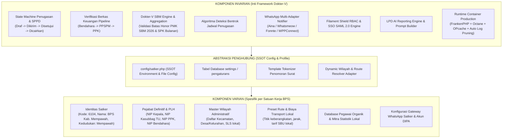

# 02. Rencana Pelaksanaan Fase 2: Generalisasi Framework Dokter-V Multi-Satker

> [!INFO] **Metadata Dokumen**
> - **ID Rencana**: `PLN-PHASE-02`
> - **Fase**: Fase 2 — *Satker Framework Generalization & Invariant/Variant Decoupling*
> - **Status**: `PROPOSED / READY FOR EXECUTION`
> - **Dokumen Induk**: [Roadmap Keseluruhan Dokter-V](../../ROADMAP.md) | [Katalog Roadmap](../README.md)
> - **Target Implementasi**: Satuan Kerja Badan Pusat Statistik (BPS) Kabupaten/Kota se-Indonesia

---

## 1. Latar Belakang dan Tujuan

Aplikasi **Dokter-V** berawal sebagai solusi otomasi administrasi, persuratan tugas, dan tata kelola honor mitra statistik di BPS Kabupaten Mempawah (Satker 6104). Seiring dengan terbuktinya efektivitas sistem ini dalam mencegah bentrok penugasan, memastikan kepatuhan batas honor SBM 2026, dan mempermudah approval pimpinan via WhatsApp, **banyak Satker BPS Kabupaten/Kota lain yang menyatakan minat untuk mereplikasi dan menerapkan Dokter-V di kantor mereka**.

Namun, pada basis kode awal masih terdapat sejumlah komponen dan data spesifik BPS Mempawah yang tertanam (*hardcoded* atau *tightly coupled*), seperti:
1. Kode satker `6104` dan `61041` yang tersebar pada logika format penomoran surat ([`NomorSurat.php`](file:///home/ihza/Projects/sipedas/app/Models/NomorSurat.php)) dan master SLS.
2. Daftar kecamatan, preset rute perjadin, dan koordinat perjalanan dinas yang masih mengunci 9 kecamatan di wilayah Kabupaten Mempawah ([`PresetRutePerjadin.php`](file:///home/ihza/Projects/sipedas/app/Models/PresetRutePerjadin.php)).
3. Seeder data awal yang menyertakan data pegawai organik Mempawah ([`PegawaiSeeder.php`](file:///home/ihza/Projects/sipedas/database/seeders/PegawaiSeeder.php)).
4. Teks antarmuka autentikasi dan template surat yang menyebutkan identitas "BPS Kabupaten Mempawah".

### Tujuan Fase 2:
Membangun abstraksi arsitektural yang **memisahkan secara tegas antara komponen INVARIAN (inti framework) dan VARIAN (parameter spesifik satker)**, serta menyediakan **mekanisme inisialisasi yang instan, ramah pengembang (*developer-friendly*), dan minim friksi** agar pengembang di satker BPS manapun dapat menjalankan Dokter-V dalam hitungan menit.

---

## 2. Pemisahan Komponen: Invarian vs. Varian

Prinsip utama modularisasi Dokter-V adalah: **"Tulis sekali logika tata kelolanya, sesuaikan parameternya per kantor."**

### Matriks Klasifikasi Rinci

| Dimensi | Invarian (Tetap Sama di Semua Satker BPS) | Varian (Dikonfigurasi per Satker BPS) |
|:---|:---|:---|
| **Alur Kerja (Workflow)** | Alur verifikasi pembayaran keuangan, siklus hidup Surat Tugas, mode delegasi approval (Kasubbag TU / Kepala). | Penerima tugas definitif, pejabat penandatangan, nomor rekening tujuan pencairan. |
| **Aturan Honor & SPK** | Rumus batas SBM honor mitra (Survei Rp 3.353.000, Sensus Rp 4.694.000), aturan konsolidasi kontrak bulanan. | Daftar nama mitra, besaran target kegiatan, alokasi anggaran MAK/DIPA satker. |
| **Penomoran Surat** | Logika counter urut tahunan, pencegahan nomor ganda, reset tahun baru, format baku arsip BPS (KP, PL, VS). | Kode satker pada surat (misal: `61041` vs `32041`), kode seksi pembina teknis. |
| **Perjalanan Dinas (SPPD)** | Logika anti-bentrok tanggal, struktur formulir SPPD 1.2 dan 1.3 Perka BPS, template visum. | Titik kedudukan kantor, kecamatan tujuan, daftar desa, waktu tempuh, dan tarif transport lokal. |
| **Autentikasi** | Integrasi SAML 2.0 (SSO BPS rIDM), mode darurat email/password, manajemen peran (RBAC) Filament Shield. | Base URL satker, entity ID SAML, nama instansi pada halaman login, mode login aktif. |
| **Notifikasi** | Normalisasi nomor telepon (`628...`), sistem preferensi opt-out, template pesan WhatsApp dinamis. | Nomor WhatsApp bot satker, API Key provider WhatsApp (Whatsmeow/Aina/Fonnte). |
| **Infrastruktur** | Dockerfile multi-stage (FrankenPHP 8.4), auto-pruning log, rotasi log daily, Caddyfile reverse-proxy. | Domain produksi (misal: `admin.dvlpid.my.id` vs `sipedas.bps3204.id`), kredensial database. |

---

## 3. Struktur Dokumen Pelaksanaan Terinci (Numbered Sub-Plans)

Karena implementasi Fase 2 mencakup banyak aspek teknis dan dapat berkembang hingga puluhan modul, setiap komponen dipecah menjadi **berkas rencana bernomor mandiri (*numbered sub-plans*)** pada folder ini:

| No. | Kode Dokumen | Rencana Kerja & Spesifikasi Teknis | Status | Prioritas |
|:---:|:---|:---|:---:|:---:|
| 01 | [**01_ssot_konfigurasi_satker.md**](01_ssot_konfigurasi_satker.md) | Abstraksi SSOT Konfigurasi Satker (`config/satker.php` & Helper Fallback) | `Proposed` | P0 (Kritis) |
| 02 | [**02_tokenizer_penomoran_surat.md**](02_tokenizer_penomoran_surat.md) | Mesin Penomoran Surat Berbasis Token (Surat Tugas, SPPD, BAST, SPK) | `Proposed` | P0 (Kritis) |
| 03 | [**03_desentralisasi_wilayah_dan_rute.md**](03_desentralisasi_wilayah_dan_rute.md) | Desentralisasi Master Wilayah, Rute Perjadin, dan Prompt LPD AI | `Proposed` | P1 (Tinggi) |
| 04 | [**04_cli_setup_wizard_satker_init.md**](04_cli_setup_wizard_satker_init.md) | Interactive CLI Setup Wizard (`php artisan satker:init`) | `Proposed` | P1 (Tinggi) |
| 05 | [**05_scaffolding_import_export_data.md**](05_scaffolding_import_export_data.md) | Starter Pack: Data Pejabat, Pegawai, Mitra, & Master SLS (Template & Lokasi) | `Proposed` | P0 (Kritis) |
| 06 | [**06_developer_quickstart_kit.md**](06_developer_quickstart_kit.md) | Developer Quickstart Kit, Docker Dev Starter, & Panduan Onboarding | `Proposed` | P1 (Tinggi) |
| 07 | [**07_branding_dan_kop_surat_dinamis.md**](07_branding_dan_kop_surat_dinamis.md) | Branding, Logo Satker, dan Komponen Kop Naskah Dinas PDF Dinamis | `Proposed` | P2 (Menengah) |
| 08 | [**08_alokasi_anggaran_dipa_mak.md**](08_alokasi_anggaran_dipa_mak.md) | Manajemen Akun Anggaran DIPA, Kode MAK, dan Validasi Pagu Belanja | `Proposed` | P2 (Menengah) |
| 09 | [**09_gateway_whatsapp_satker.md**](09_gateway_whatsapp_satker.md) | Profil Multi-Gateway WhatsApp Satker (Whatsmeow/Aina/Fonnte/WAHA) | `Proposed` | P2 (Menengah) |
| 10 | [**10_qa_matrix_regresi_mempawah.md**](09_gateway_whatsapp_satker.md) | Matriks QA, Multi-Satker Test Suite, dan Garansi Zero-Regresi Mempawah | `Proposed` | P0 (Kritis) |
| 11 | [**11_fleksibilitas_autentikasi_dan_sso.md**](11_fleksibilitas_autentikasi_dan_sso.md) | Fleksibilitas Autentikasi: Mode Lokal (Email/Password), SSO SAML, dan Hybrid | `Proposed` | P0 (Kritis) |

---

## 4. Rencana Tahapan Eksekusi (Execution Timeline)

Pelaksanaan 11 modul bernomor di atas diorganisasikan ke dalam timeline bertahap:

```mermaid
gantt
    title Roadmap Pelaksanaan Fase 2: Generalisasi Framework Dokter-V
    dateFormat  X
    axisFormat W%W
    section Milestones
    01. Abstraksi SSOT Konfigurasi Satker             :active, m1, 0, 3
    02. Mesin Penomoran Surat Berbasis Token          :m2, after m1, 3
    03. Desentralisasi Preset Rute & Wilayah          :m3, after m2, 4
    04. Interactive Satker Setup Wizard CLI           :m4, after m3, 3
    05. Scaffolding Import/Export Data Satker         :m5, after m4, 3
    06. Developer Quickstart Kit & Onboarding         :m6, after m5, 2
    07-09. Branding, DIPA, & WhatsApp Satker          :m7, after m6, 3
    10. QA Verification & Zero-Regression Gauntlet    :m8, after m7, 2
    11. Fleksibilitas Autentikasi & Login Fallback    :m9, after m8, 2
```

---

### Ringkasan Teknis Modul Inti:

#### Milestone 2.1: Abstraksi SSOT Konfigurasi Satker
- **Target**: Membuat konfigurasi terpusat yang menjadi *Single Source of Truth* (SSOT) untuk seluruh identitas dan parameter kantor.
- **Rujukan Teknis**: [01_ssot_konfigurasi_satker.md](01_ssot_konfigurasi_satker.md)

#### Milestone 2.2: Mesin Penomoran Surat Berbasis Token
- **Target**: Menghilangkan string format hardcoded `/61041/...` pada model [`NomorSurat.php`](file:///home/ihza/Projects/sipedas/app/Models/NomorSurat.php) dan menggantinya dengan template token dinamis.
- **Rujukan Teknis**: [02_tokenizer_penomoran_surat.md](02_tokenizer_penomoran_surat.md)

#### Milestone 2.3: Desentralisasi Preset Rute Perjalanan Dinas & Master Wilayah
- **Target**: Menghapus dependensi hardcoded 9 kecamatan Mempawah di [`PresetRutePerjadin.php`](file:///home/ihza/Projects/sipedas/app/Models/PresetRutePerjadin.php) dan menghubungkannya dengan data wilayah lokal yang dinamis.
- **Rujukan Teknis**: [03_desentralisasi_wilayah_dan_rute.md](03_desentralisasi_wilayah_dan_rute.md)

#### Milestone 2.4: Interactive Satker Setup Wizard CLI (`php artisan satker:init`)
- **Target**: Membangun perintah CLI interaktif yang memandu pengembang satker lain menyiapkan konfigurasi awal dalam waktu kurang dari 3 menit tanpa menyentuh kode program.
- **Rujukan Teknis**: [04_cli_setup_wizard_satker_init.md](04_cli_setup_wizard_satker_init.md)

#### Milestone 2.5: Scaffolding Import/Export Data Pegawai & Mitra Satker
- **Target**: Memudahkan pemindahan data pegawai dan mitra statistik dari satker lain ke dalam Dokter-V via template CSV/Excel resmi.
- **Rujukan Teknis**: [05_scaffolding_import_export_data.md](05_scaffolding_import_export_data.md)

#### Milestone 2.6: Developer Quickstart Kit & Docker Dev Starter
- **Target**: Memastikan setiap pengembang lokal di satker lain dapat melakukan *one-command startup*.
- **Rujukan Teknis**: [06_developer_quickstart_kit.md](06_developer_quickstart_kit.md)

#### Milestone 2.7–2.9: Branding, Anggaran DIPA, & Gateway WhatsApp
- **Target**: Logo dinamis di kop surat PDF, alokasi MAK DIPA, dan konfigurasi bot WhatsApp multi-provider.
- **Rujukan Teknis**: [07_branding_dan_kop_surat_dinamis.md](07_branding_dan_kop_surat_dinamis.md), [08_alokasi_anggaran_dipa_mak.md](08_alokasi_anggaran_dipa_mak.md), [09_gateway_whatsapp_satker.md](09_gateway_whatsapp_satker.md)

#### Milestone 2.10: Matriks QA & Garansi Zero-Regresi Mempawah
- **Target**: Menjamin bahwa seluruh perubahan framework 100% kompatibel dan tidak merusak operasional di BPS Mempawah.
- **Rujukan Teknis**: [10_qa_matrix_regresi_mempawah.md](10_qa_matrix_regresi_mempawah.md)

#### Milestone 2.11: Fleksibilitas Autentikasi & Login Fallback
- **Target**: Mendukung opsi login darurat/lokal email-password bagi satker yang belum memiliki integrasi SSO SAML BPS rIDM.
- **Rujukan Teknis**: [11_fleksibilitas_autentikasi_dan_sso.md](11_fleksibilitas_autentikasi_dan_sso.md)

---

## 5. Matriks Evaluasi & Quality Gate

Untuk memastikan transisi ke framework multi-satker tidak merusak stabilitas yang sudah ada di BPS Mempawah (*Zero Regression*):

| Gerbang Mutu (Quality Gate) | Kriteria Lolos (Passing Criteria) | Alat Verifikasi |
|:---|:---|:---|
| **Backward Compatibility** | Seluruh konfigurasi default tetap mengacu ke BPS Mempawah (6104) jika satker lain belum melakukan konfigurasi kustom. | `php artisan test` (100% lulus) |
| **Pemisahan Invarian/Varian** | 0 hardcoded string kode satker atau nama kecamatan di core service (`app/Services/`). Seluruhnya membaca dari `config('satker.*')`. | `grep_search` & PHPStan Level 5 |
| **CLI Idempotency** | Perintah `php artisan satker:init` aman dijalankan berulang kali tanpa merusak integritas basis data. | Unit Test khusus `SatkerInitCommandTest` |
| **Storage Safety** | Rotasi log `daily` dan pruning log >50MB tetap aktif di semua konfigurasi satker baru. | `StorageMaintenanceTest` |

---

## 6. Rujukan Dokumen Terkait
- [Dokter-V Overall Roadmap](../../ROADMAP.md)
- [Katalog Roadmap](../README.md)
- [Arsitektur Sistem (arc42)](../../architecture/01_introduction_and_goals.md)
- [Aturan Bisnis & Kontrak (Business Rules)](../../BUSINESS_RULES.md)
- [Dokumentasi Panduan Produksi](../../../PRODUCTION_GUIDE.md)
